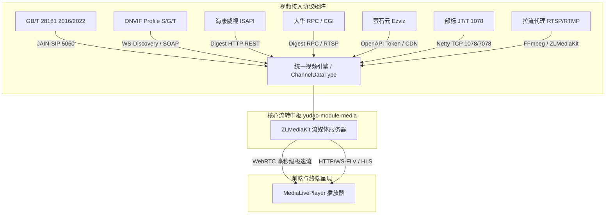
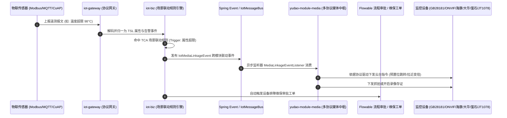

# MzMedia 项目 AI Agent 全局开发规范与模块技术全景文档

> **文档版本**：v2.0 (2026.11)  
> **适用对象**：所有参与 MzMedia 开发的 AI Agent（Coding Assistant）、架构师与核心研发人员  
> **核心原则**：规范先验、模块自治、上游兼容、协议归一、安全闭环

---

## 目录 (Table of Contents)

- [一、 项目定位与核心战略](#一-项目定位与核心战略)
- [二、 技术栈基准与环境规格](#二-技术栈基准与环境规格)
- [三、 工程总体架构与模块全景](#三-工程总体架构与模块全景)
- [四、 各核心功能模块深度技术解析](#四-各核心功能模块深度技术解析)
  - [4.1 视频监控与流媒体中心 (`yudao-module-media`)](#41-视频监控与流媒体中心-yudao-module-media)
  - [4.2 物联网引擎与多协议网关 (`yudao-module-iot`)](#42-物联网引擎与多协议网关-yudao-module-iot)
  - [4.3 Spring AI 驱动的智能中枢与 MCP Agent (`yudao-module-ai1-springai`)](#43-spring-ai-驱动的智能中枢与-mcp-agent-yudao-module-ai1-springai)
  - [4.4 工业产供销与工程交付协同 (`mes` / `wms` / `pms`)](#44-工业产供销与工程交付协同-mes--wms--pms)
  - [4.5 企业中枢与通用服务模块 (`report` / `pay` / `mp` / `system` / `infra`)](#45-企业中枢与通用服务模块-report--pay--mp--system--infra)
  - [4.6 前端工程架构与播放器集成 (`ui`)](#46-前端工程架构与播放器集成-ui)
- [五、 跨模块协同与事件总线规范](#五-跨模块协同与事件总线规范)
- [六、 Git 协作与官方上游同步规范](#六-git-协作与官方上游同步规范)
- [七、 AI Agent 行为准则与架构防线（强约束）](#七-ai-agent-行为准则与架构防线强约束)
- [八、 研发排错与常见陷阱排查手册 (FAQ)](#八-研发排错与常见陷阱排查手册-faq)

---

## 一、 项目定位与核心战略

### 1.1 平台使命
**MzMedia** 是一款专为**中小企业量身打造的企业级 AI 驱动物联网与视频融合平台**。平台基于成熟的 `ruoyi-vue-pro` 企业级底座深度孵化，深度融合 **物联网感知 (IoT)**、**安防音视频 (GB/T 28181 & WebRTC)** 与 **生成式 AI (Spring AI / MCP)**。

### 1.2 破解四大行业痛点
1. **协议碎片化严重**：通过“AI 智能逆向推导编解码器 + 统一物模型（TSL）抽象”，抹平 Modbus、MQTT、CoAP、GB28181 及非标 TCP/UDP 差异。
2. **系统数据孤岛**：基于单一底座贯通 IoT 采集、视频巡视、PMS 项目交付、MES 制造执行、WMS 仓储库存与 Flowable 工作流，避免多套独立系统的重复采购与割裂。
3. **设备与视频割裂**：依托系统内解耦的事件总线，实现传感器超限秒级驱动 GB28181 云台球机转动预置位、录像与抓拍，同屏融合呈现“看数据”与“看现场”。
4. **运维实施成本高**：支持 Docker-Compose 一键编排，融合 TDengine 列式时序库节约 80% 存储成本，结合 RAG 知识库与 MCP Tools 赋予运维人员自然语言故障诊断能力。

---

## 二、 技术栈基准与环境规格

| 领域 | 核心技术选型 | 版本规格 | 说明与开发约束 |
| :--- | :--- | :--- | :--- |
| **基础语言与环境** | Java (JDK) | **21+** | 必须使用 JDK 21 语法特性（虚拟线程、模式匹配、文本块）；Maven 编译参数开启 `-parameters` |
| **基础脚手架** | Spring Boot | **4.1.2** / Spring 6.x | 遵循自动装配规范，禁止循环依赖滥用，支持 WebFlux/SSE 流式输出 |
| **持久层与 ORM** | MyBatis-Plus / Dynamic-Datasource | **3.5.x** / MyBatis-Plus-Join | 强制使用 Lambda 条件构造器；多数据源主库走 MySQL，时序走 TDengine |
| **业务数据库** | MySQL | **8.0+** | 字符集 `utf8mb4`，排序规则 `utf8mb4_unicode_ci`，表与字段全小写下划线 |
| **时序数据库** | TDengine | **3.0+** | 存储海量时序属性与遥测上报，超级表设计，列式高压缩存储 |
| **缓存与数据结构** | Redis / Redisson | **6.0+ / 7.0+** | 存储 Token、设备在线状态、分布式锁、Redis Stream 消息总线及向量索引 |
| **消息总线 (Bus)** | Redis Stream / Kafka / RocketMQ | 可配置插拔 | 默认配置 `type: redis`，支持高吞吐场景切换为 Kafka/RocketMQ |
| **MQTT Broker** | EMQX | **5.0+** | 工业网关与传感器标准化接入 Broker，集成 Webhook 与认证鉴权 |
| **流媒体服务器** | ZLMediaKit | 核心 Docker 节点 | 支持 RTSP/RTMP/GB28181-RTP/WebRTC/FLV/HLS 多协议拉转推与 REST Hook |
| **视频监控协议网关** | GB28181 / ONVIF / ISAPI / RPC / Ezviz / JT1078 | 国标 2016/2022、ONVIF Profile S/G/T、海康 ISAPI、大华 RPC/CGI、萤石 OpenAPI、部标 JT/T 1078 (Netty 1078/7078) | 多协议安防与车载视频综合接入中枢，统一转码与 PTZ 云台调度 |
| **国标 SIP 协议栈** | JAIN SIP (NIST) / GB28181 | 2016 / 2022 国标 | 端口 `5060`，支持 UDP/TCP 双栈信令与鉴权 |
| **AI 智能中枢** | Spring AI + 官方 Java MCP SDK | **1.1+** | 对接 18+ 主流大模型厂商；支持 MCP Client（stdio 与 http-streamable 双通道） |
| **工作流引擎** | Flowable | **7.0** | 支撑设备报修、巡检保养工单与工程项目审批 |
| **管理前端** | Vue 3 + TypeScript + Vite | **Vue 3.4+ / TS 5.4+** | Element Plus、Pinia、UnoCSS、VXE-Table、Jessibuca/WFS 视频播放器 |
| **数字大屏** | GoView | Vue3 + NaiveUI + ECharts | 低代码拖拽物联大屏、3D 组态、GIS 拓扑 |

---

## 三、 工程总体架构与模块全景

### 3.1 模块拓扑关系

```mermaid
flowchart TD
    yudao_dependencies["yudao-dependencies\n(统一版本BOM)"] --> yudao_framework["yudao-framework\n(核心Starter基础设施)"]
    yudao_framework --> yudao_module_system["yudao-module-system\n(权限/用户/租户/OAuth2)"]
    yudao_framework --> yudao_module_infra["yudao-module-infra\n(代码生成/Job/文件/日志)"]
    
    yudao_module_system --> yudao_server["yudao-server\n(应用统一主入口 / 8080)"]
    yudao_module_infra --> yudao_server
    
    yudao_framework --> yudao_module_media["yudao-module-media\n(★ 视频中心/GB28181/ZLMediaKit)"]
    yudao_framework --> yudao_module_iot["yudao-module-iot\n(★ 物联网核心/网关/物模型/规则引擎)"]
    yudao_framework --> yudao_module_ai1["yudao-module-ai1-springai\n(★ Spring AI/MCP/Agent/知识库)"]
    
    yudao_framework --> yudao_module_pms["yudao-module-pms\n(工程项目交付/知识库)"]
    yudao_framework --> yudao_module_mes["yudao-module-mes\n(智能制造执行/设备维保/工单)"]
    yudao_framework --> yudao_module_wms["yudao-module-wms\n(智能仓储/备件出入库/盘点)"]
    yudao_framework --> yudao_module_report["yudao-module-report\n(GoView大屏/积木报表)"]
    yudao_framework --> yudao_module_pay["yudao-module-pay\n(全渠道支付通道)"]
    yudao_framework --> yudao_module_mp["yudao-module-mp\n(微信公众号管理)"]
    yudao_framework --> yudao_module_ai["yudao-module-ai\n(原生RuoYi AI体验)"]

    yudao_module_media --> yudao_server
    yudao_module_iot --> yudao_server
    yudao_module_ai1 --> yudao_server
    yudao_module_pms --> yudao_server
    yudao_module_mes --> yudao_server
    yudao_module_wms --> yudao_server
    yudao_module_report --> yudao_server
    yudao_module_pay --> yudao_server
    yudao_module_mp --> yudao_server
    yudao_module_ai --> yudao_server

    ui["ui/ (现代化 Vue 3 独立前端)"] -.->|REST / WebSocket| yudao_server
```



### 3.2 目录与职责速查表

| 工程目录 / 模块 | 模块定位 | 内部子模块或关键包路径 | 核心业务职责 |
| :--- | :--- | :--- | :--- |
| **`yudao-dependencies`** | Maven BOM | `pom.xml` | 锁定整个系统全部第三方库版本（Spring Boot 4.1.2、Lombok 1.18.48、MapStruct 1.7.0.Beta2、ZLMediaKit SDK、JAIN SIP、Netty 等）。 |
| **`yudao-framework`** | 框架组件层 | `yudao-common`<br/>`*-starter-mybatis`<br/>`*-starter-redis`<br/>`*-starter-security`<br/>`*-starter-biz-tenant`<br/>`*-starter-biz-data-permission`<br/>`*-starter-web`<br/>`*-starter-websocket` | 封装全套企业级通用 Starter：租户隔离、数据权限切面、Redis 幂等限流、全局异常拦截、MyBatis-Plus 自动填充、WebSocket 广播通道。 |
| **`yudao-module-media`** | 视频监控中心 | `cn.iocoder.yudao.module.media`<br/>├── `gb28181` (SIP信令栈/设备/通道)<br/>├── `onvif` (ONVIF WS-Discovery/SOAP客户端/PTZ)<br/>├── `hikvision` (海康威视 ISAPI Digest REST/PTZ/抓图)<br/>├── `dahua` (大华 RPC/CGI/RTSP/PTZ/快照)<br/>├── `ezviz` (萤石云 Token缓存/FLV与HLS直播/云台)<br/>├── `jt1078` (JT/T 1078 车载音视频 Netty 网关)<br/>├── `media` (ZLMediaKit Hook对接)<br/>├── `streamProxy` (拉流代理)<br/>├── `streamPush` (推流分发)<br/>└── `vmanager` (录像/抓拍/报警控制/集群看板) | 多协议视频接入中枢（GB/T 28181、ONVIF、海康 ISAPI、大华 RPC/CGI、萤石云、部标 JT/T 1078）；ZLMediaKit 节点管理与 RTP 端口调度；视频录像计划与云端切片；全协议 PTZ 云台控制与预置位联动。 |
| **`yudao-module-iot`** | 物联网接入中枢 | ├── `yudao-module-iot-core`<br/>├── `yudao-module-iot-gateway`<br/>└── `yudao-module-iot-biz` | **三层架构**：<br/>1. `core`：TSL 物模型规范、消息体定义、`IotMessageBus` 消息总线接口；<br/>2. `gateway`：Netty/Vert.x 13+ 协议网关（MQTT、Modbus、CoAP、TCP/UDP、HTTP、WS）；<br/>3. `biz`：设备资产、Modbus 点位调度、OTA 升级、数据分发规则（9 Sink）与 TCA 场景联动规则。 |
| **`yudao-module-ai1-springai`**| AI 驱动中枢 | `cn.iocoder.yudao.module.ai1`<br/>├── `harness` (LLM/MCP/Skill/RAG/Memory)<br/>├── `service.agent` (Agent 编排)<br/>├── `service.mcp` (MCP 客户端管理)<br/>└── `service.knowledge` (向量检索) | 基于 Spring AI 1.1+ 与 Model Context Protocol（MCP）构建；支持本地 stdio 与远程 HTTP MCP 客户端；提供 Skill 物化沙箱、时序运维 RAG 诊断助手、私有协议逆向解析。 |
| **`yudao-module-mes`** | 智能制造执行 | `cn.iocoder.yudao.module.mes`<br/>├── `cal` (生产日历/班次排班)<br/>├── `dv` (设备台账/点检/保修)<br/>├── `md` (BOM/SOP/工位/编码规则)<br/>├── `pro` (工序/工艺路线/工单/报工/安灯)<br/>├── `qc` (IQC/IPQC/OQC 质量检验)<br/>└── `wm` (车间仓储/批次/SN/盘点) | 覆盖车间生产排产、工艺路线、工单流转、生产报工与安灯（Andon）预警；设备运行维护与保养记录闭环；产品全生命周期质量追溯。 |
| **`yudao-module-wms`** | 智能仓储管理 | `cn.iocoder.yudao.module.wms`<br/>├── `md` (仓库/库区/库位/货品/货主/SKU)<br/>├── `order` (入库/出库/调拨/盘点单据)<br/>└── `inventory` (库存流水/锁定扣减) | 仓储主数据配置、采购入库、生产领料出库、销售出库、库内移库调拨、动态循环盘点；库存锁定与先进先出（FIFO）管控。 |
| **`yudao-module-pms`** | 项目交付与协同 | `cn.iocoder.yudao.module.pms`<br/>├── `pm` (项目/迭代/工作项/看板/工时)<br/>└── `kb` (企业知识库/文档/权限/分享) | 面向中小企业物联网工程项目全周期管理（立项、勘测、安装、调试、终验）；需求与缺陷看板协同；支持 Markdown/富文本知识库沉淀。 |
| **`yudao-module-report`** | 大屏与报表中心 | `ajreport`、`goview`、`ureport2` | 开箱集成 GoView 低代码大屏拖拽设计器；集成积木报表（JimuReport）打印套打与复杂格式报表。 |
| **`yudao-module-system`** | 核心权限与组织 | `auth`、`user`、`dept`、`permission`、`tenant`、`oauth2`、`sms`、`mail` | RBAC 细粒度权限控制、多租户强隔离、单点登录（SSO）、敏感操作日志审计、消息模板中心。 |
| **`yudao-module-infra`** | 基础设施与工具 | `codegen`、`job`、`file`、`db`、`redis`、`logger` | 代码生成器（可一键生成增删改查前端与后端代码）、Quartz/XXL 分布式定时任务、对象存储客户端、API 访问与异常日志。 |
| **`yudao-server`** | 主应用工程引导 | `src/main/resources/application*.yaml` | Spring Boot 启动类 `YudaoServerApplication` 所在位置；集成全量业务配置与启动参数。 |
| **`ui`** | 平台专有管理前端 | `ui/src/views/media`<br/>`ui/src/views/iot`<br/>`ui/src/views/system` | 采用 Vue 3.4 + TypeScript 构建的前端工程；集成了视频点播/回放组件、物模型可视化设计器、告警规则设计器。 |

---

## 四、 各核心功能模块深度技术解析

### 4.1 视频监控与流媒体中心 (`yudao-module-media`)

#### 4.1.1 核心数据库实体 (`sql/module/media-2026-11-12.sql`)
- `wvp_device`：国标/监控设备主表（国标 ID `deviceId`、SIP 域 `domain`、IP 端口、传输协议 TCP/UDP、注册时间、心跳时间、状态）。
- `wvp_device_channel`：设备通道表（通道 ID `channelId`、通道名称、PTZ 类型、经纬度、子通道列表、在线状态、推流地址、`dataType` 接入协议类型）。
- `wvp_media_server`：ZLMediaKit 流媒体服务器节点（ID、HTTP 端口、RTMP/RTSP 端口、RTP 端口范围、REST Secret、Hook 回调配置）。
- `wvp_platform` / `wvp_platform_channel`：上级国标平台级联表，支撑向上级公安或集团平台级联推送目录与视频流。
- `wvp_stream_proxy`：外部 RTSP/RTMP/HTTP 拉流代理任务表（自动拉流并转协议分发）。
- `wvp_stream_push`：自主推流管理表。
- `wvp_cloud_record` / `wvp_record_plan`：云端录像记录与定时录像计划表。
- `wvp_device_onvif`：ONVIF 协议设备表（IP、端口、账号、密码、Profiles、StreamUri、状态）。
- `wvp_device_hik`：海康威视 ISAPI 设备表（IP、端口、账号、密码、通道数、设备型号DeviceInfo、状态）。
- `wvp_device_dahua`：大华 RPC/CGI 设备表（IP、端口、账号、密码、通道数、设备信息、状态）。
- `wvp_device_ezviz`：萤石云开放平台设备表（AppKey、AppSecret、设备序列号DeviceSerial、通道号ChannelNo、验证码、直播地址）。
- `wvp_device_jt1078`：部标 JT/T 1078 车载终端表（SIM卡号、逻辑通道号、车牌号PlateNumber、转推流ID、状态）。
- `iot_device.video_config`：IoT 设备视频流媒体配置（JSON 格式：协议、关联通道、流地址、云台控制标志等）。

#### 4.1.2 GB/T 28181 信令交互全链路
1. **设备注册与鉴权**：
   - 设备发送 `REGISTER` -> 本地 SIP Stack 响应 `401 Unauthorized` 携带 `nonce` -> 设备使用 MD5 密码重新发送 `REGISTER` -> 校验通过，存储/刷新 Redis 会话，写入 `wvp_device`。
2. **设备保活 (Keepalive)**：
   - 监听设备的 `MESSAGE` 请求，解析 XML 内容中的 `<CmdType>Keepalive</CmdType>`，更新设备最新心跳时间，心跳超时触发离线事件。
3. **通道目录检索与订阅 (Catalog)**：
   - 系统主动发送 `Catalog` 查询请求，接收设备分批上报的通道列表 XML 响应，解析通道国标编码规则（第 11-13 位代表类型：132 摄像机、131 报警通道、200 网络视频服务器等），入库 `wvp_device_channel`。
4. **实时点播 (Live Playback)**：
   ```text
   前端请求 Play -> MediaServer 分配本地动态 RTP 接收端口 -> 发送 SIP INVITE (携带 SDP)
   -> 摄像机返回 200 OK (携带摄像机媒体 SDP) -> 本地发送 ACK -> 摄像机向 ZLMediaKit 推送 RTP 流
   -> ZLMediaKit 触发 Hook (on_publish) -> 转为 WebRTC/HTTP-FLV/WS-FLV/HLS -> 返回播放 URL 给前端
   ```
5. **云台控制 (PTZ Control)**：
   - 通过 `ISIPCommander.frontEndCmd(device, channelId, cmdCode, horizonSpeed, verticalSpeed, zoomSpeed)` 下发字节码控制帧。
   - 包含云台八向微调、焦距变大/变小、光圈缩放、预置位设置/调用/删除（**预置位调用指令码：129 即 `0x81`**）、巡航轨迹与自动扫描。
6. **双向语音对讲 (Voice Talk)**：
   - 支持 G.711A/G.711U 格式双向音频流转发，通过 ZLMediaKit 音频通道实现浏览器麦克风声音采集、编码推流至摄像机扬声器。

#### 4.1.3 多协议视频接入全矩阵 (深度技术规范)

系统在传统 GB28181 基础上，全面升级扩展了安防与车载主流协议接入引擎：



1. **ONVIF 协议栈 (`cn.iocoder.yudao.module.media.onvif`)**：
   - **设备探测**：基于 WS-Discovery 协议向局域网广播组播包（`239.255.255.250:3702`），探测局域网内所有兼容摄像机；
   - **SOAP 认证**：采用 WS-UsernameToken 摘要鉴权（Password Digest = `Base64(SHA-1(nonce + created + password))`）；
   - **流与配置解析**：调用 `GetProfiles` 获取设备配置，调用 `GetStreamUri` 获取高/标清 RTSP 取流地址；
   - **云台控制**：封装 `ContinuousMove`（八向速度矢量 `[-1.0, 1.0]`）、`Stop` 及 `GotoPreset` 预置位调用。
2. **海康威视 ISAPI 协议 (`cn.iocoder.yudao.module.media.hikvision`)**：
   - **通信鉴权**：基于 OkHttp3 摘要认证拦截器 (`DigestAuthenticator`) 与海康设备 ISAPI 接口通信；
   - **信息与通道同步**：调用 `/ISAPI/System/deviceInfo` 获取型号固件；遍历 `/ISAPI/ContentMgmt/InputProxy/channels` 同步所有模拟/网络通道；
   - **RTSP 取流**：自动构建海康标准取流地址 `rtsp://admin:password@ip:port/Streaming/channels/101`（101 主码流、102 子码流）；
   - **PTZ 与抓图**：调用 `/ISAPI/PTZCtrl/channels/{id}/continuous` 下发连续云台运动指令；调用 `/ISAPI/Streaming/channels/{id}/picture` 获取高清现场快照。
3. **大华 HTTP RPC / CGI 协议 (`cn.iocoder.yudao.module.media.dahua`)**：
   - **RPC 交互**：基于 Digest 摘要认证调用大华设备 CGI 服务；
   - **通道探测**：调用 `/cgi-bin/magicBox.cgi?action=getSystemInfo` 与 `/cgi-bin/configManager.cgi?action=getConfig&name=ChannelTitle` 提取通道名称列表；
   - **RTSP 流规范**：统一拼接大华标准取流 URL `rtsp://username:password@ip:port/cam/realmonitor?channel={ch}&subtype=0`；
   - **云台与快照**：调用 `/cgi-bin/ptz.cgi?action=start&channel={ch}&code={code}&arg1={speed}&arg2={speed}` 驱动云台，调用 `/cgi-bin/snapshot.cgi?channel={ch}` 抓取快照。
4. **萤石云开放平台 (`cn.iocoder.yudao.module.media.ezviz`)**：
   - **Token 托管**：维护 `appKey` 与 `appSecret`，自动换取并缓存 `accessToken`（过期前自动刷新）；
   - **直播流拉取**：调用 `/api/lapp/v2/live/address/get` 获取超低延迟 FLV/HLS 直播地址；
   - **云台与抓图**：调用 `/api/lapp/device/ptz/start` & `/stop` 远程调向，调用 `/api/lapp/device/capture` 触发云端抓拍并获取 CDN 图片链接。
5. **部标 JT/T 1078 车载音视频网关 (`cn.iocoder.yudao.module.media.jt1078`)**：
   - **标准遵循**：严格符合《JT/T 1078-2016 道路运输车辆卫星定位系统 视频通信协议》；
   - **双端口监听**：Netty 高性能服务端监听视频通道 `1078` 端口与信令指令 `7078` 端口；
   - **报文帧解码**：识别 4 字节固定帧头魔数 `0x30 0x31 0x63 0x64`，解码 BCD 终端手机号/SIM、逻辑通道号（1-驾驶员, 2-车辆正前, 3-车内全景, 4-车后门等）、数据类型（I帧/P帧/B帧/音频帧）、时间戳及 Payload；
   - **会话与转推**：`JT1078SessionManager` 维持车载终端连接，通过 Netty 管道将音视频数据解封装并转推至 ZLMediaKit RTP 收流端口完成多协议分发。

#### 4.1.4 跨协议统一点播与云台/预置位联动架构

为了让上层业务与前端完全解耦底层协议差异，系统采用插件化多态设计：

1. **统一通道类型枚举 (`ChannelDataType.java`)**：
   - `0`：GB28181 国标协议
   - `1`：拉流代理 (StreamProxy)
   - `2`：推流任务 (StreamPush)
   - `4`：ONVIF 协议
   - `5`：海康威视 (ISAPI)
   - `6`：大华 (RPC/CGI)
   - `7`：萤石云 (Ezviz)
   - `200`：部标 JT/T 1078
2. **Spring Bean 服务多态约定**：
   - 各协议分别实现 `@Service(ChannelDataType.PLAY_SERVICE + ChannelDataType.XXX)`（点播/停止拉流服务）；
   - 各协议分别实现 `@Service(ChannelDataType.PTZ_SERVICE + ChannelDataType.XXX)`（云台控制服务）；
   - 统一调度入口：全局统一路由 `/api/common/channel/play`、`/api/common/channel/play/stop` 及 `/api/front-end/ptz` 无需任何分支重构，天然支持所有协议。
3. **事件驱动引擎跨协议精准联动 (`MediaLinkageEventListener.java`)**：
   - 监听 IoT 模块发布的 `IotMediaLinkageEvent` 事件；
   - 依据通道设备编号前缀（`onvif_`、`hik_`、`dh_`、`ezviz_`、`jt_` 及 `gb28181_`）自动路由，实现传感器告警秒级联动球机转动预置位与录像抓拍。

#### 4.1.5 前端“视频中心”全套架构设计 (`ui/yudao-ui-admin-vue3`)

1. **核心播放器组件 (`src/components/MediaLivePlayer/index.vue`)**：
   - 支持 WebRTC (毫秒级超低延迟)、HTTP-FLV、HLS 自由切换；
   - 8向 360° 交互式云台圆盘（上/下/左/右/左上/右上/左下/右下/复位）；
   - 变倍（Zoom +/-）、聚焦（Focus +/-）、光圈（Iris +/-）精细微调；
   - 云台转动速度滑块控制（1 ~ 255）；
   - 预置位列表快速调用与现场抓拍截图下载；
   - 一键网页/系统全屏，音频静音与音量调节。
2. **视频中心 7 大核心业务页面 (`src/views/media/`)**：
   - **实时预览** (`live/index.vue`, 菜单 26010)：1/4/9/16 多分屏自由切换，左侧通道目录树，双击上屏，一键全部停止；
   - **设备管理** (`device/index.vue`, 菜单 26020)：多协议设备管理 Tab（GB28181、ONVIF局域网探测、海康ISAPI、大华RPC、萤石云、JT1078、拉流代理），通道同步抽屉；
   - **录像回放** (`playback/index.vue`, 菜单 26030)：24小时连续时间轴刻度（绿色有效区间标注与游标拖拽），0.5x~4x 倍速播放与下载；
   - **录像计划** (`recordPlan/index.vue`, 菜单 26040)：周一至周日 7×24 小时录像计划时间段编辑器，通道批量穿梭框关联；
   - **流媒体服务** (`server/index.vue`, 菜单 26050)：ZLMediaKit 节点负载指标看板，CPU/内存监控，在线自检；
   - **电子地图** (`map/index.vue`, 菜单 26060)：电子地图监控点位分布视图，经纬度标注与摄像机脉冲指示点，点击弹窗实时点播；
   - **报警记录** (`alarm/index.vue`, 菜单 26070)：移动侦测、视频遮挡、周界入侵等报警事件流，级别标识、抓拍快照预览、单条删除与一键清空。

#### 4.1.6 IoT 视频设备模型与场景联动机制

1. **产品与设备模型扩展**：
   - `IotProductDeviceTypeEnum.java`：新增 `VIDEO(3, "视频监控设备")` 及 `isVideo()` 判定；
   - 在 `IotDeviceDO` 及 VO 中新增 `videoConfig` 扩展字段，用于存储监控协议、流地址、绑定通道及云台参数。
2. **前端 IoT 表单与详情联动**：
   - `DeviceForm.vue`：新增“视频监控配置”折叠项，支持快速选择视频中心已接入的通道直接绑定；
   - `DeviceDetailsVideo.vue`：在 IoT 设备详情页新增“视频监控”Tab，嵌入播放器与云台控制，支持传感器告警时联动摄像机转动预置位与录像抓拍。

---

### 4.2 物联网引擎与多协议网关 (`yudao-module-iot`)

#### 4.2.1 整体分层架构

```
┌─────────────────────────────────────────────────────────────────────────────┐
│                          yudao-module-iot-biz (业务层)                      │
│   · 设备全生命周期 (IotDevice)         · Modbus 点位轮询调度 (IotModbus)       │
│   · 产品与品类管理 (IotProduct)        · OTA 固件任务流转 (IotOta)            │
│   · 物模型 TSL 管理 (IotThingModel)    · 告警配置与履历 (IotAlert)            │
│   ★ TR-069 CWMP 管理 (IotDeviceCwmp)   · TR-369 USP 终端控制 (IotDeviceUsp)   │
├─────────────────────────────────────────────────────────────────────────────┤
│   ★ 规则引擎双核心：                                                        │
│   1. 数据分发引擎 (IotDataRule): SpEL 过滤 -> 9 种 Sink 输出 (TDengine/MQ等) │
│   2. 场景联动引擎 (IotSceneRule): Trigger -> Condition -> Action (联动视频等)│
├─────────────────────────────────────────────────────────────────────────────┤
│                      yudao-module-iot-core (核心模型与总线)                  │
│   · IotMessageBus (消息总线抽象: Redis Stream / Kafka / RocketMQ)          │
│   · TSL 物模型规范 (Property/Service/Event)   · 设备消息体 (IotDeviceMessage) │
│   ★ TR-069 SOAP 编解码 (CwmpSoapParser/Builder)                            │
│   ★ TR-369 Protobuf 编解码 (UspProtobufCodec/Builder)                       │
│   ★ TR-181/TR-098 物模型统一映射器 (Tr181ThingModelMapper)                  │
├─────────────────────────────────────────────────────────────────────────────┤
│                    yudao-module-iot-gateway (协议网关与接入)                │
│   · MQTT / EMQX 5.0 (长连接)         · Modbus TCP / RTU (工业 PLC / 仪表)    │
│   · CoAP (窄带 NB-IoT / 电池传感器)   · TCP / UDP (私有定长/分隔符报文)       │
│   · HTTP REST / WebHook (主动推送)    · WebSocket (双全工大屏推送)            │
│   ★ TR-069 ACS (Vert.x HTTP :9292 / 会话状态机 / Connection Request 唤醒)   │
│   ★ TR-369 MTP (Vert.x MQTT :18833 / WebSocket / Protobuf Record 路由)     │
└─────────────────────────────────────────────────────────────────────────────┘
```

#### 4.2.2 核心数据库实体 (`sql/iot_tr069_tr369.sql` & `sql/module/iot-*.sql`)
- `iot_product` / `iot_product_category`：物联产品与品类（接入协议类型包括 TR069、TR369_MQTT、TR369_WEBSOCKET，数据格式 JSON/Custom/TR069_SOAP/TR369_USP，网络类型，物模型模板）。
- `iot_device`：设备实体表（设备名称、ProductKey、DeviceSecret、在线状态、最后活跃时间、设备影子 JSON、网关子设备父子拓扑）。
- `iot_thing_model`：物模型定义表（属性 Identifier、数据类型 int/float/string/bool/enum/struct/array、读写权限、事件级别、服务入参与出参）。
- `iot_device_modbus_config` / `iot_device_modbus_point`：工业 Modbus 采集配置表（从站地址 SlaveId、轮询周期、寄存器类型 01/02/03/04、寄存器地址、缩放系数、数据类型、读写属性）。
- `iot_device_cwmp_config` / `iot_device_cwmp_param`：TR-069 CPE 连接认证配置表与参数树快照表（支持 TR-098/TR-181 规范、ConnectionRequestURL、周期上报 Inform 设置）。
- `iot_device_usp_config` / `iot_device_usp_param`：TR-369 USP Agent 连接配置表与参数快照表（Agent Endpoint ID、Controller Endpoint ID、MTP 类型、MQTT Topic 路由）。
- `iot_data_rule` / `iot_data_sink`：数据分发规则与目的地配置表。
- `iot_scene_rule`：TCA 场景联动规则表（触发器、触发条件、执行动作配置）。
- `iot_alert_config` / `iot_alert_record`：告警规则阈值配置与告警触发历史记录。
- `iot_ota_firmware` / `iot_ota_task` / `iot_ota_task_record`：OTA 升级固件包、批次升级任务与单个设备升级进度记录（支持 TR-069 `<cwmp:Download>` 与 USP `Device.Download()` 联动）。

#### 4.2.3 规则引擎双核心技术规格
1. **数据分发引擎 (`IotDataRuleService` & `IotDataSinkService`)**：
   - **报文过滤**：基于 SpEL 表达式或 JSONPath 进行上报数据条件判断（如 `#payload.temp > 50`）。
   - **9 种 Sink 输出通道**：
     - `TDengine`（列式时序入库，超高速并发写入）
     - `MySQL / PostgreSQL`（关系型数据库归档）
     - `Redis Stream`（内存流分发）
     - `Kafka` / `RocketMQ` / `RabbitMQ`（企业级分布式消息管道）
     - `HTTP Webhook`（向第三方应用推送 JSON）
     - `MQTT Broker`（重新发布至指定 Topic，驱动边缘执行）
     - `TCP / WebSocket Client`（下发至指定网络链路）
2. **场景联动引擎 (TCA: Trigger-Condition-Action)**：
   - **Trigger 触发器**：属性上报触发 (`IotDevicePropertyPostTriggerMatcher`)、事件上报触发 (`IotDeviceEventPostTriggerMatcher`)、设备状态更新 (`IotDeviceStateUpdateTriggerMatcher`)、服务调用触发、CRON 定时触发。
   - **Condition 条件评估器**：设备属性值阈值比对、时间范围匹配（如“仅在夜间 22:00-06:00 之间生效”）、设备在线/离线状态比对。
   - **Action 动作执行器**：
     - 设置设备属性 (`IotDevicePropertySetSceneRuleAction`)
     - 调用设备服务 (`IotDeviceServiceInvokeSceneRuleAction`)
     - 产生系统告警 (`IotAlertTriggerSceneRuleAction`) 与自动解除告警
     - **视频监控联动 (`IotMediaSceneRuleAction`)**：向系统事件总线发布 `IotMediaLinkageEvent`，命令指定国标摄像头旋转至预置位或触发录像。

#### 4.2.4 宽带网络 TR-069 (CWMP) 与 TR-369 (USP) 深度集成规范

MzMedia 参考开源 Oktopus 架构，在物联网模块中原生打通了 Broadband Forum（宽带论坛）标准定义的 **TR-069 (CWMP)** 与 **TR-369 (USP)** 协议，实现对光猫（ONT/ONU）、家庭宽带网关、企业级路由器及 Wi-Fi 7 智能终端的全生命周期管控：

```
                    ┌────────────────────────────────────────────────────────┐
                    │               Web 管理后台 (Vue3 Admin)                 │
                    │   · CWMP 状态看板 / 主动唤醒 / 远程重启 / Wi-Fi配置 / 诊断 │
                    │   · USP Agent 概览 / TR-181 树 / Operate 远程命令执行器  │
                    └───────────────────────────┬────────────────────────────┘
                                                │ REST API (/iot/device-cwmp/*, /iot/device-usp/*)
                                                ▼
┌─────────────────────────────────────────────────────────────────────────────────────────────┐
│                                 yudao-module-iot-biz                                        │
│  · IotDeviceCwmpService: 参数快照维护, GetParameterNames/Values, Wi-Fi快速配置, Ping 诊断   │
│  · IotDeviceUspService: Agent Endpoint 路由, USP Get/Set/Operate, 远程 Reboot/Reset          │
│  · IotOtaTaskRecordServiceImpl: 协议自适应固件调度 (CWMP <Download> / USP Device.Download)   │
└──────────────────────────────────────┬──────────────────────────────────────────────────────┘
                                       │ 统一消息总线 (IotMessageBus)
                                       ▼
┌─────────────────────────────────────────────────────────────────────────────────────────────┐
│                               yudao-module-iot-gateway                                      │
│  ┌──────────────────────────────────────────────┐  ┌──────────────────────────────────────┐ │
│  │ IotCwmpProtocol (Vert.x HTTP ACS :9292/cwmp) │  │ IotUspMqttProtocol (Vert.x MQTT)     │ │
│  │ · Basic/Digest 认证拦截 (IotCwmpAuthHandler) │  │ · 端口 :18833 (内嵌 Vert.x MQTT Server)│ │
│  │ · 会话状态机 & 命令出队 (IotCwmpSession)      │  │ · 路由: agent/{endpointId}           │ │
│  │ · 反向主动唤醒 (Connection Request Client)   │  │ · 路由: controller/{endpointId}      │ │
│  └──────────────────────────────────────────────┘  └──────────────────────────────────────┘ │
└──────────────────────────────────────┬──────────────────────────────────────────────────────┘
                                       │ 物理链路 (SOAP XML / Protobuf Record)
                                       ▼
┌─────────────────────────────────────────────────────────────────────────────────────────────┐
│                                       终端设备层                                            │
│  · TR-069 CPE: 运营商光猫/政企网关/VoIP语音盒     · TR-369 Agent: Wi-Fi 7 智能路由/边缘容器网关 │
└─────────────────────────────────────────────────────────────────────────────────────────────┘
```

1. **TR-069 (CWMP) 规范与机制**：
   - **ACS 会话管理**：CPE 仅在发起 HTTP POST（如周期 Inform 或值变更）建立的会话中接收下行指令。平台网关基于 `IotCwmpSessionManager` 维护 Cookie 会话与待下发命令队列，在空 POST（200 OK 带 SOAP XML）中依次出队执行，全部完成后回复 204 No Content 关闭会话。
   - **反向唤醒客户端 (`IotCwmpConnectionRequestClient`)**：当设备离线或处于空闲周期时，平台使用 OkHttp + okhttp-digest 向 CPE 的 `ConnectionRequestURL` 发送带 HTTP Digest 认证的 GET 请求，主动触发 CPE 立即向 ACS 发起 Inform 建立连接。
   - **编解码与构建器**：
     - `CwmpSoapParser`：基于 DOM4J 快速解析 CPE 的 `Inform`、`GetParameterValuesResponse`、`TransferComplete`、`Fault` 报文。
     - `CwmpSoapBuilder`：标准构建 `InformResponse`、`GetParameterNames`、`GetParameterValues`、`SetParameterValues`、`Reboot`、`FactoryReset`、`Download`（OTA 固件下载）、`AddObject`、`DeleteObject` 报文。
2. **TR-369 (USP) 规范与机制**：
   - **MTP 传输通道**：支持 MQTT MTP（Vert.x 内嵌 MQTT Server 端口 `:18833`）及 WebSocket MTP。Agent 端监听 `agent/{endpointId}` 主题接收 Controller 指令，向 `controller/{endpointId}` 发布响应与通知。
   - **纯 Java Protobuf 编解码 (`UspProtobufCodec`)**：基于 Google Protobuf wire format (`CodedInputStream` / `CodedOutputStream`) 直接对 `usp-record-1-3.proto` 与 `usp-msg-1-3.proto` 规范报文进行无依赖流式序列化，彻底消除部署环境缺少本地 `protoc` 二进制工具链的风险。
   - **核心指令集**：
     - `USP Get`：路径查询参数（支持最大深度过滤）。
     - `USP Set`：对象参数修改（支持部分允许 `allowPartial`）。
     - `USP Operate`：远程调用标准 TR-181 动作（`Device.Reboot()`、`Device.FactoryReset()`、`Device.Download()`、`Device.IP.Diagnostics.IPPing()` 等）。
     - `USP Notify`：上报属性变更（ValueChange）与操作完成事件。
3. **TR-181 统一物模型 (TSL) 映射与 OTA 固件协同**：
   - **语义归一 (`Tr181ThingModelMapper`)**：将复杂的 TR-069 / TR-181 对象路径（如 `InternetGatewayDevice.DeviceInfo.SoftwareVersion`、`Device.WiFi.SSID.1.SSID`、`ExternalIPAddress`）双向自动映射为平台物模型统一属性（`firmwareVersion`、`wifiSsid`、`wanIp` 等），直接纳管进**数据分发规则引擎**（输出到 TDengine/Kafka）和**场景联动引擎**（如网络异常联动安防摄像机巡检抓拍）。
   - **自适应 OTA 固件调度 (`IotOtaTaskRecordServiceImpl`)**：创建批次升级任务时，调度器根据产品协议类型自适应识别：
     - `TR069` 协议：组装 `<cwmp:Download>` RPC（FileType 为 `"1 Firmware Upgrade Image"`）并入队等待 CPE 获取；
     - `TR369` 协议：组装 USP `Device.Download()` 操作命令直接下发至 Agent；
     - 升级完成后通过 `TransferComplete` 或 Inform 版本号变更自动流转任务状态至成功。

---

### 4.3 Spring AI 驱动的智能中枢与 MCP Agent (`yudao-module-ai1-springai`)

#### 4.3.1 架构与设计理念
`yudao-module-ai1-springai` 是面向 AIoT 融合场景专用的 Agent 开发套件。不同于市面上简单的 Prompt 聊天包装，它实现了：
1. **Model Context Protocol (MCP) 深度集成**：采用官方 Java MCP SDK (`io.modelcontextprotocol.client.McpSyncClient`)，提供 `stdio`（本地子进程运行）与 `http`（Streamable HTTP 远程调用）双传输协议。
2. **全生命周期 Agent 编排**：支持 System Prompt、多工具（MCP Tools、系统内置函数、HTTP 抓取）、多知识库（RAG）、会话短记忆与长期归档记忆。
3. **Skill 物化沙箱 (`Ai1SkillToolFactory`)**：支持用户在后台维护多层级代码/脚本文件树，在运行时动态将 Skill 内容物化到隔离沙箱中供智能体执行。

#### 4.3.2 核心数据库表结构 (`create_tables.sql`)
- `ai1_provider`：模型供应商表（OpenAI、DeepSeek、Claude、Gemini、通义千问、豆包、混元等，配置 BaseUrl、API Key、加密 Headers）。
- `ai1_model`：模型元数据表（Model 标识如 `deepseek-chat`、`gpt-4o`、类型：Chat、Embedding、Image）。
- `ai1_mcp`：MCP 服务端注册表（传输类型 `stdio` / `http`、连接 URL、启动命令与参数、动态工具列表缓存与配置指纹）。
- `ai1_agent`：智能体配置表（绑定的模型、系统角色设定 System Prompt、挂载的 MCP 服务列表、关联的知识库列表、关联的 Skill 列表、长期记忆开关）。
- `ai1_knowledge_base` / `ai1_knowledge_document`：RAG 知识库与知识文档表（分块大小 ChunkSize、重叠度 ChunkOverlap、Top-K 召回量、向量化状态）。
- `ai1_skill` / `ai1_skill_file`：技能与技能多层级文件树表（实现动态代码加载与沙箱注入）。
- `ai1_session` / `ai1_session_message`：会话与消息历史表（支持流式 SSE Token 输出持久化）。
- `ai1_memory`：长期记忆与事实归档表。

#### 4.3.3 AI 在 MzMedia 中的核心落地能力
1. **私有非标工业协议智能逆向解析**：
   - 工程师输入设备协议 PDF 规范或抓包十六进制报文（如 `01 03 00 00 00 02 C4 0B`）；
   - AI Agent 自动推导报文结构、校验和（CRC16-Modbus、LRC 等），一键生成对应的 Java Netty 解码器代码并完成单元测试编译。
2. **AIoT 智能时序运维诊断**：
   - 暴露 MCP Tools 查询 TDengine 历史数据、设备告警记录与视频快照；
   - 运维人员用自然语言发问：“*注塑机 3 号昨天下午为什么停机？*”，AI 自动拉取温升曲线、告警日志并结合企业知识库输出排查建议。
3. **跨系统协同与自然语言下发**：
   - 工程师说：“*把厂区所有高压配电房球机转向预置位 1 并巡检一遍温度*”，AI 解析为批量国标信令下发并返回结果。

---

### 4.4 工业产供销与工程交付协同 (`mes` / `wms` / `pms`)

#### 4.4.1 工程项目交付中心 (`yudao-module-pms`)
- **物联网工程全流程**：项目立项 -> 现场勘测 -> 网关部署 -> 传感器接线 -> 通电入网 -> 竣工验收。
- **工作项追踪 (WorkItem)**：支持需求（Requirement）、任务（Task）、缺陷（Bug）三种类型，多工作流状态自定义，支持敏捷看板与甘特图。
- **项目知识库 (KB)**：项目文档、勘测图纸、接线图、验收文档多级目录管理，支持评论、收藏、分享与细粒度权限控制。

#### 4.4.2 数字化制造执行 (`yudao-module-mes`)
- **主数据管理 (MD)**：编码规则自动生成、客户/供应商管理、物料主数据（支持物料 BOM 清单、SOP 标准作业指导书、SIP 标准检验规程）、工作站与工位。
- **计划与排程 (CAL)**：工厂日历、法定节假日、班次（早中夜班）、班组与排班计划。
- **设备运维与台账 (DV)**：设备资产档案、点检计划与记录、保养计划与保养记录、设备报修与故障维修工单闭环（**可与 IoT 设备报警自动联动产生报修单**）。
- **生产制造流转 (PRO)**：工艺流程与工艺路线、生产工单与流转卡（Card）、工序生产任务派工、生产报工（Feedback）、安灯呼叫（Andon，设备故障或缺料一键叫停）。
- **质量检验管控 (QC)**：进料质检 (IQC)、过程巡检与工序质检 (IPQC)、出货质检 (OQC)、退货质检 (RQC)、质检指标与缺陷代码库。
- **车间线边仓与条码 (WM)**：生产领料/退料、成品报产入库、批次管理、物料 SN 序列号追踪、动态盘点任务。

#### 4.4.3 智能仓储管理 (`yudao-module-wms`)
- **主数据层**：多仓库、库区、库位三级结构，货主（Merchant）与商品 SKU。
- **单据流转核心**：
  - 入库管理：采购入库单、退货入库单 -> 验货上架；
  - 出库管理：发货出库单、领料出库单 -> 拣货下架与复核；
  - 库内作业：移库调拨单（库位迁移）、盘点单（明盘/暗盘）与损益调整。
- **库存台账**：实时可用库存、冻结库存（单据预占）、在途库存管理。

---

### 4.5 企业中枢与通用服务模块 (`report` / `pay` / `mp` / `system` / `infra`)

- **数据大屏与报表 (`yudao-module-report`)**：
  - 开箱集成 **GoView**：拖拽式物联大屏、3D 组态、高德/百度 GIS 拓扑，直接对接 TDengine 与 MySQL REST 接口；
  - 集成积木报表（`jimureport`）与 `ureport2`，满足复杂打印与出货单套打需求。
- **全渠道支付体系 (`yudao-module-pay`)**：
  - 统一抽象微信支付（Native/JSAPI/App/H5）、支付宝（扫码/网页/App）、模拟钱包与渠道退款对账。
- **微信公众号 (`yudao-module-mp`)**：
  - 微信菜单、自动回复、图文消息、粉丝标签与模板消息通知（用于设备超限微信即时告警卡片下发）。
- **系统核心底座 (`yudao-module-system`)**：
  - **SaaS 多租户架构**：基于 `tenant_id` 自动 SQL 注入拦截（`yudao-spring-boot-starter-biz-tenant`），保证租户数据强隔离；
  - **RBAC 权限模型**：用户、角色、菜单权限与数据权限（全部、本部门、本部门及子部门、仅本人、自定义部门列表）。
  - **统一认证中心**：基于 Spring Security + Redis 实现 Token 认证、OAuth2.0 协议支持与社交账号登录。
- **基础设施与运维 (`yudao-module-infra`)**：
  - **代码生成器 (Codegen)**：基于数据库表结构一键生成 Controller、Service、DAO、Mapper XML、DTO/VO 及前端 Vue3 页面代码；
  - **分布式任务调度 (Job)**：动态管理与监控 Quartz/定时调度任务；
  - **分布式对象存储 (File)**：统一适配 MinIO、本地磁盘、阿里云 OSS、腾讯云 COS，支撑视频切片与固件文件上传。

---

### 4.6 前端工程架构与播放器集成 (`ui`)

#### 4.6.1 技术架构与视图结构
- 基于 Vite 5 + Vue 3.4 + TypeScript 5.4 + Pinia 构建；
- 核心视图目录：
  - `src/views/media`：直播点播 (`live`)、云端录像 (`cloudRecord`)、录像计划 (`recordPlan`)、推拉流管理 (`streamProxy`/`streamPush`)、国标级联平台 (`platform`)、视频报警记录 (`alarm`)。
  - `src/views/iot`：设备列表与详情 (`device`)、物模型可视化管理 (`thingsModel`)、协议管理 (`protocol`)、编解码器配置 (`codec`)、场景规则与数据分发 (`sceneRule`/`sceneTrigger`/`alertRule`)、国标 SIP 配置 (`sipConfig`/`sipDevice`/`sipChannel`)、流媒体服务器状态 (`mediaServer`)。
  - `src/views/workflow`：流程模型设计器、审批工单流转。

#### 4.6.2 视频播放器矩阵集成规范
为适应不同浏览器与低延迟需求，前端组件化封装了主流多媒体播放引擎：
1. **Jessibuca 播放器**：首选用于 WebRTC、HTTP-FLV、WS-FLV 播放，支持 H.264/H.265 硬解码，延迟低于 1 秒，支持录屏、截图与 PTZ 云台十字控制轮盘。
2. **WFS / Flv.js**：用于兼容低版本浏览器或纯 WebSocket-FLV 传输场景。
3. **HLS.js**：用于公网弱网切片点播回放。

---

## 五、 跨模块协同与事件总线规范

平台杜绝模块间的强引用耦合。模块间协同严格遵循 **Spring ApplicationEvent 进程内解耦** 或 **IotMessageBus 跨服务解耦**：



### 5.1 典型跨模块事件：`IotMediaLinkageEvent`
- **定义位置**：`yudao-framework/yudao-common/src/main/java/cn/iocoder/yudao/framework/common/event/IotMediaLinkageEvent.java`
- **发布方**：`IotMediaSceneRuleAction`（属于 `yudao-module-iot` 场景规则动作执行器）
- **消费方**：`MediaLinkageEventListener`（属于 `yudao-module-media` 媒体监听器）
- **跨协议自适应路由**：
  - 自动识别通道设备前缀（`onvif_`、`hik_`、`dh_`、`ezviz_`、`jt_` 及 `gb28181_`）；
  - 针对国标设备下发 SIP XML 控制帧（预置位调用指令码 129 即 `0x81`）；
  - 针对 ONVIF 设备下发 SOAP `GotoPreset`；
  - 针对海康设备下发 ISAPI PUT `/ISAPI/PTZCtrl/channels/{id}/presets/{id}/goto`；
  - 针对大华设备下发 RPC CGI `ptz.cgi?action=start&code=GotoPreset`；
  - 针对萤石云设备下发 OpenAPI PTZ 控制指令；
  - 针对 JT1078 车载设备下发信令对讲与抓图。
- **支持动作**：
  - `ptz_preset`：调用预置位（指令码 129 即 `0x81`）
  - `record_start`：启动设备端录像
  - `record_stop`：停止录像
  - `snapshot`：实时抓拍现场照片存证并上传至对象存储 (MinIO/OSS)

---

## 六、 Git 协作与官方上游同步规范

MzMedia 基于官方 `ruoyi-vue-pro` 演进而来，为了持续获取官方上游的安全补丁与核心框架升级，**必须严格遵循双远端架构与标准化同步流程**。

### 6.1 远程源与分支架构

| 远程源名称 | 仓库地址 | 权限与职责 |
| :--- | :--- | :--- |
| **`origin`** | `https://gitee.com/mzmedia/mz-media.git` | **团队自有仓库**。拥有读写权限，日常研发、特性分支均推送到此。 |
| **`upstream`** | `https://gitee.com/zhijiantianya/ruoyi-vue-pro.git` | **官方上游仓库**。只读源，仅用于定期拉取官方最新代码与框架更新。 |

```text
[upstream/master-jdk25] (官方上游)
          │  git pull --ff-only upstream master-jdk25
          ▼
   official-jdk25      (本地纯净镜像，★ 绝对红线：严禁提交业务代码)
          │  git merge official-jdk25
          ▼
         dev            (★ 团队业务开发主基线) ──push──> [origin/dev]
          │
          ├── feature/xxx  (具体特性开发分支)
          └── hotfix/xxx   (紧急 Bug 修复分支)
```

### 6.2 提交规范 (Conventional Commits)
格式必须严格满足：`<type>(<scope>): <subject>`

- **Type 说明**：
  - `feat`：新增业务功能（如 `feat(media): 支持国标设备云台巡航扫描`）
  - `fix`：修复 Bug（如 `fix(sip): 修复 TCP 模式下分包粘包解析异常`）
  - `refactor`：重构代码（既非新功能，也非修复 Bug）
  - `perf`：性能优化（如 `perf(iot): 优化 Modbus 点位采集并发调度`）
  - `docs`：文档调整（如 `docs(agent): 更新模块架构图`）
  - `style`：代码格式变动（空格、换行、标点，不影响逻辑）
  - `chore`：依赖变更、上游同步、配置文件变更
- **Scope 规范范围**：`media`、`iot`、`ai1`、`mes`、`wms`、`pms`、`system`、`infra`、`ui`、`server`、`deps`。

### 6.3 上游同步标准化 4 步法
当官方 `upstream/master-jdk25` 有框架升级或重要修复时：

```bash
# 步骤 1：确认当前工作区干净
git status
git stash # 若有未提交改动先行暂存

# 步骤 2：纯净更新本地官方基准分支
git checkout official-jdk25
git pull --ff-only upstream master-jdk25

# 步骤 3：切回团队主基线合并官方更新
git checkout dev
git merge official-jdk25

# 步骤 4：核查定制文件冲突并解决
# 重点核查：根 pom.xml、yudao-dependencies/pom.xml、yudao-server/application*.yaml
# 解决冲突后编译验证并提交：
git commit -m "chore: 同步 upstream/master-jdk25 官方更新"
git push origin dev
git push origin official-jdk25
git stash pop # 恢复暂存
```

---

## 七、 AI Agent 行为准则与架构防线（强约束）

凡受命修改或编写本平台代码的 **AI Agent**，必须**无条件执行**以下防线约束：

### 7.1 五大开发防线

```
┌────────────────────────────────────────────────────────────────────────┐
│                   AI Agent 行为约束与架构防线体系                      │
├────────────────────────────────────────────────────────────────────────┤
│ 1. 模块隔离防线 │ 业务代码严格归属对应 module，严禁污染 framework/system │
├────────────────────────────────────────────────────────────────────────┤
│ 2. 配置隔离防线 │ 新增配置必须放在专属命名空间下，严禁硬编码敏感凭据    │
├────────────────────────────────────────────────────────────────────────┤
│ 3. 数据库防线   │ 严禁改动官方 ruoyi-vue-pro.sql，增量脚本独立日期递增 │
├────────────────────────────────────────────────────────────────────────┤
│ 4. 编码规范防线 │ 强制三层架构，统一 CommonResult，MapStruct 做 VO 映射 │
├────────────────────────────────────────────────────────────────────────┤
│ 5. 上游兼容防线 │ 严禁触碰 official-jdk25 分支，严禁改动 Java 21 编译参数│
└────────────────────────────────────────────────────────────────────────┘
```

#### 防线一：业务逻辑独立模块化防线
- **视频业务**（SIP、ZLMediaKit、WebRTC、PTZ）代码**必须**放在 `yudao-module-media` 中。
- **物联网核心**（协议网关、TSL 物模型、规则引擎、Modbus、TR-069/TR-369 宽带网关）代码**必须**放在 `yudao-module-iot` 中。
- **AI 智能体**（Spring AI、MCP、Agent 编排）代码**必须**放在 `yudao-module-ai1-springai` 中。
- **严禁侵入核心底座**：**绝对禁止**直接修改 `yudao-framework` 或 `yudao-module-system` 的内部核心逻辑！若需要扩展框架能力，必须使用 **Spring 继承拓展**、**`@Primary` Bean 覆盖** 或 **AOP 切面注入** 实现。
- **宽带网关协议（TR-069 / TR-369）开发守则**：
  - **TR-069 会话交互铁律**：CPE 遵循反向请求/响应模式，平台严禁脱离 CPE 会话向下强推 SOAP 指令。下行指令必须暂存于会话队列；当 CPE 空闲时，必须通过 `IotCwmpConnectionRequestClient` 主动触发反向唤醒。
  - **TR-369 编解码规范**：必须使用基于标准 Java 的 `UspProtobufCodec`，严禁在 Maven 构建或部署流程中引入对本地 `protoc` 二进制文件的强依赖。
  - **物模型映射一致性**：新增 TR-181/TR-098 参数时，优先在 `Tr181ThingModelMapper` 中建立映射，确保无缝接入平台的数据分发与场景联动规则引擎。

#### 防线二：配置文件隔离防线
- 禁止在根配置 `application.yaml` 中大规模修改官方现有参数；
- 新增业务配置必须挂载在专属命名空间下：
  - 视频模块：`sip:`、`media:`、`user-settings:`
  - 物联网模块：`yudao.iot:`
  - AI 模块：`yudao.ai:`、`spring.ai:`
- **安全底线**：严禁将任何真实的生产数据库密码、第三方 API Key、云存储密钥硬编码提交到 Git 仓库，统一使用环境变量占位符（如 `${OPENAI_API_KEY:sk-xxxx}`）。

#### 防线三：数据库脚本增量管理防线
- **绝对禁止修改官方基线脚本**：严禁直接篡改 `sql/mysql/ruoyi-vue-pro.sql`。
- **增量脚本规范**：所有新增业务表、新增字段、新增菜单与字典，必须以独立文件形式存储在 `sql/module/` 下，命名规则为 `模块名-yyyy-MM-dd.sql`（例如 `sql/module/media-2026-11-10.sql`）。

#### 防线四：代码设计与分层规范防线
- **三层架构分层**：
  - `Controller`：只负责入参校验（`@Valid`）、权限控制（`@PreAuthorize`）与结果组装，**禁止在 Controller 中书写核心业务逻辑**。
  - `Service` / `ServiceImpl`：承载所有核心业务事务与流程控制。
  - `DAL`（Data Access Layer）：分为 `dataobject`（DO 实体）与 `mysql`（Mapper 接口），使用 MyBatis-Plus。
- **数据转换统一标准**：
  - 强制使用 **MapStruct** 编写转换器接口（如 `DeviceConvert.INSTANCE.convert(do)`），**严禁在代码中写几十行手工重复的 `get/set`**，也不建议使用性能损耗严重的 `BeanUtils.copyProperties`。
- **接口返回结构统一**：
  - 所有 API 返回类型必须为 `CommonResult<T>`，成功使用 `CommonResult.success(data)`，失败使用 `ServiceException` 抛出，由全局异常拦截器 `GlobalExceptionHandler` 统一收敛，禁止返回未包装的裸对象。
- **多租户与数据隔离**：
  - 属于租户层级的业务表必须包含 `tenant_id` 字段（`bigint NOT NULL DEFAULT 0`）。
  - 若某些后台调度任务（Job）需要跨所有租户执行，必须使用 `TenantUtils.execute(tenantId, () -> { ... })` 显式包裹。

#### 防线五：Java 21 与编译环境防线
- 项目已全面升级至 **Java 21** 与 **Spring Boot 4.1.2**，严禁引入已过时的 Javax 包（必须使用 `jakarta.*`，如 `jakarta.annotation.Resource`、`jakarta.validation.Valid`）。
- 根目录 `pom.xml` 中必须保留 `<compilerArgs><arg>-parameters</arg></compilerArgs>`，以确保 Spring Boot 参数名反射推导正常运作。

---

## 八、 研发排错与常见陷阱排查手册 (FAQ)

### 8.1 视频与流媒体 (Media / GB28181) 常见问题
1. **设备注册显示成功，但点播提示 404 或超时**：
   - 检查 ZLMediaKit 容器是否正常运行，宿主机的 `30000-30500` RTP 端口范围是否被防火墙阻断。
   - 检查 `application.yaml` 中的 `media.ip` 是否配置为设备可达的局域网/公网 IP（不可配置为 `127.0.0.1`，否则设备无法推流）。
2. **设备通道目录获取不到或通道列表为空**：
   - 检查摄像机配置的 SIP 服务器域与编码是否与系统匹配（国标 20 位 ID 规则）。
   - 检查分包传输机制：部分老旧摄像机通道超过 20 个时分包发送，需确认 `CatalogQueryCmd` 是否完整接收分包通知。
3. **云台 PTZ 控制失灵**：
   - 确认所选通道类型为可控云台（球机或带云台枪机）；检查指令码是否正确（预置位调用使用 `129`）。

### 8.2 物联网引擎 (IoT) 常见问题
1. **Modbus 点位读取出现负数或数值异常**：
   - 检查点位配置的字节序（Endianness）：大端模式（Big-Endian）、小端模式（Little-Endian）、高低字节反转（CDAB/BADC）。
   - 检查寄存器地址偏移量：PLC 地址从 1 开始计还是从 0 开始计（0-based vs 1-based）。
2. **时序数据库 TDengine 写入报错**：
   - 确认 TDengine 服务端版本与客户端驱动版本匹配（推荐 3.0+）；
   - 检查超级表（STable）与子表自动创建机制，子表表名合法性过滤（禁止包含特殊字符）。
3. **场景规则联动视频无响应**：
   - 检查 `IotMediaLinkageEvent` 监听器是否生效；
   - 检查绑定的 `deviceId` 和 `channelId` 在 `mz_device_channel` 中是否存在且当前设备处于 `online=true` 状态。
4. **TR-069 CPE 周期上报 Inform 失败（401 Unauthorized）**：
   - 检查 CPE 中配置的 ACS URL 是否包含正确路径（默认 `http://<ip>:9292/cwmp`）；
   - 检查 CPE 认证用户名密码是否与 `iot_device_cwmp_config` 中的 `acs_username` / `acs_password` 匹配，注意区分 HTTP Basic 与 Digest 鉴权类型。
5. **TR-069 Connection Request 主动唤醒超时或不可达**：
   - CPE 处于私网/NAT 后面且无公网 IP 时，ACS 直接 HTTP GET 访问 `ConnectionRequestURL` 会超时。需确保 CPE 与 ACS 处于同一局域网、或 CPE 建立了反向 VPN 隧道、或在 CPE 端配置有效 STUN 服务。
6. **TR-369 USP Agent 接收不到 Operate/Set 命令**：
   - 确认 Agent 订阅的主题为 `agent/{endpointId}`，Controller 下发的主题与 `endpointId` 完全匹配；
   - 检查 protobuf 编解码日志，确认 Record 的 `to_id` 与 Agent Endpoint 标识一致；检查 MTP 协议（默认使用 Vert.x MQTT Server 端口 `:18833`）。

### 8.3 AI 与 MCP 模块常见问题
1. **启动时提示 `ChatClient.Builder` 重复定义报错**：
   - 原因：项目中同时引入了多套大模型 Client，Spring Boot 默认自动配置要求唯一的 Bean。
   - 解决：确保 `spring.ai.chat.client.enabled: false`，通过 `Ai1LlmModelFactory` 显式创建指定供应商的 ChatModel。
2. **MCP stdio 客户端启动超时**：
   - 检查本地进程运行环境（Node.js / Python / Executable）是否在系统 PATH 中，检查进程启动入参与工作目录。
3. **SSE 流式输出乱码**：
   - 确保 `spring.servlet.encoding.charset: UTF-8` 且 `force: true`，确保流式输出头部设置 `Content-Type: text/event-stream;charset=UTF-8`。

---

> 🎯 **结语**：本文档是 MzMedia 平台的生命线与最高开发指导规范。所有 AI Agent 在接到开发或修复指令后，请首先对照本文档的相关章节审查设计思路，坚守模块边界与安全红线，共同守护高效、优雅、健壮的企业级开源底座！
