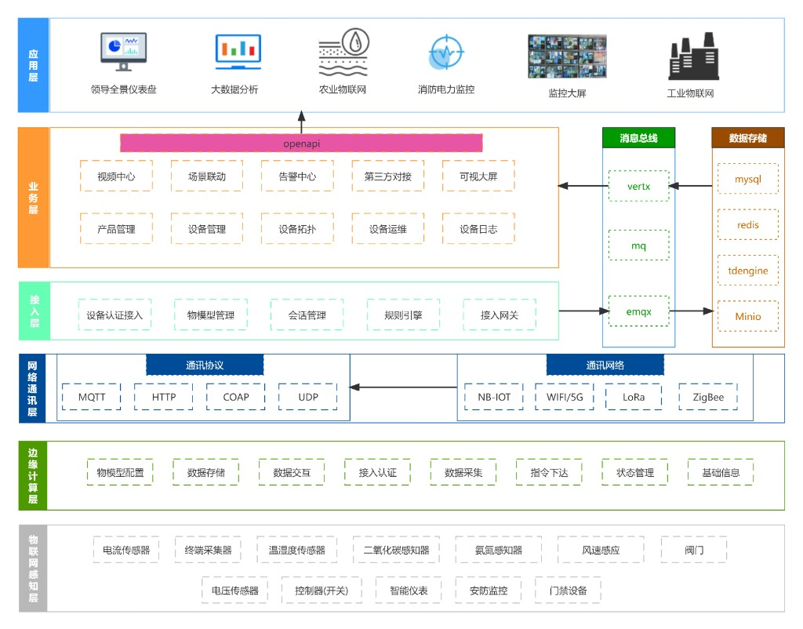

# MzMedia - 企业级 AI 驱动物联网与视频融合平台

<p align="center">
  
  
  
  
  
  
  
  
</p>

## 📌 平台简介

**MzMedia** 是一款专为**中小企业量身打造的企业级 AI 驱动物联网与视频融合平台**。平台基于成熟的 `ruoyi-vue-pro` 企业级底座深度重构与孵化，深度融合 **物联网（IoT）**、**安防音视频（GB28181 / WebRTC）** 与 **生成式 AI（Spring AI / MCP）** 技术。

针对中小企业在数字化升级中普遍面临的 **“协议碎片化、系统各自为政、数据烟囱林立、商业套件成本高昂”**等核心痛点，MzMedia 提供了从**设备立项、物模型配置、低成本协议接入、多设备联动、实时监控大屏、到智能运维工单闭环**的全生命周期管理能力，实现**设备接入低成本、跨协议集成智能化、业务系统无缝打通**的新一代 AIoT 解决方案。

> 🌐 **代码仓库**：
> - Gitee：[https://gitee.com/mzmedia/mz-media.git](https://gitee.com/mzmedia/mz-media.git)
> - GitHub：[https://github.com/MzMedia/MzMedia.git](https://github.com/MzMedia/MzMedia.git)
> - 官方文档：[https://mzmedia.github.io/](https://mzmedia.github.io/)

---

## ⚡ 核心破局：解决中小企业“数据烟囱”顽疾

中小企业在工业制造、智慧农业、园区物业和消防电力等场景进行物联网改造时，往往陷入**“买得起设备，建不起平台，通不起数据”**的困境：

| 行业痛点 | 传统烟囱式系统现状 | MzMedia 破局解决方案 |
| :--- | :--- | :--- |
| **协议碎片严重** | 工控 PLC 走 Modbus、传感器走 MQTT/CoAP、安防走 GB28181/ONVIF、老设备走私有 TCP/UDP，协议各异，联调周期数月。 | **AI 辅助逆向解析 + 统一物模型抽象**：借助大模型自动生成私有协议编解码器，通过物模型（TSL）彻底抹平协议差异。 |
| **系统数据烟囱** | 传感器数据在采集系统、视频画面在安防录像机、工单流转在钉钉/微信、项目交付在 Excel，各个孤岛互不相通。 | **全子系统协同底座**：基于 RuoYi-Vue-Pro 将 IoT、视频中心、PMS项目管理、MES/WMS仓储制造与工作流深度拉通，单一平台闭环。 |
| **设备与视频割裂** | 传感器报警不知道现场发生了什么，摄像头巡检无法调取设备实时运行参数，联动靠人工电话通知。 | **多设备与音视频全域联动**：传感器超限秒级触发摄像头云台 PTZ 旋转至预置位巡视并抓拍，视频流与时序数据同屏联动。 |
| **交付运维成本高** | 商业 IoT 软件授权昂贵，定制门槛高，设备故障完全依赖老师傅“事后救火”，缺少预测与远程运维能力。 | **中小企业轻量级低成本全生命周期管理**：开源可商用，支持 Docker 一键部署；结合 TDengine 时序大数据与 AI 辅助故障诊断。 |

---

## 🏗️ 系统总体架构

MzMedia 采用清晰的层次化设计，覆盖感知层、边缘计算、协议接入、消息总线、业务中台到数字驾驶舱的完整端到端链路：

<p align="center">
  
</p>

### 架构分层详解

| 架构层级 | 核心模块 / 覆盖组件 | 职责与能力说明 |
| :--- | :--- | :--- |
| **应用层 (Application)** | 领导全景仪表盘、大数据分析、智慧农业、消防电力监控、监控大屏、工业物联网 | 面向决策者与业务方的综合驾驶舱与行业套件，支持大屏低代码拖拽与全屏沉浸式展现。 |
| **业务层 (Business)** | 统一 OpenAPI、视频中心、场景联动、告警中心、第三方对接、可视大屏、产品管理、设备管理、设备拓扑、设备运维、设备日志 | 承载业务核心逻辑，基于 RuoYi-Vue-Pro 提供 PMS 项目交付、设备资产履历、告警工单闭环及开放接口。 |
| **接入层 (Access)** | 设备认证接入、物模型管理（TSL）、会话管理、规则引擎、接入网关 | 维持长连接会话，解析并校验身份凭证，将异构报文解构为标准化属性、事件与服务模型。 |
| **消息总线与存储** | **消息总线**：Vert.x、Redis Stream / RocketMQ / Kafka、EMQX 5.0<br/>**数据存储**：MySQL、Redis、TDengine（海量时序）、MinIO（流媒体与文件） | 支持百万级设备并发上报，时序数据列式高压缩存储，动静数据分离保障查询毫秒级响应。 |
| **网络通讯层 (Network)** | **通讯网络**：NB-IoT、WiFi / 5G、LoRa、ZigBee、以太网<br/>**通讯协议**：MQTT、HTTP/HTTPS、CoAP、UDP、TCP、Modbus、GB/T 28181、ONVIF | 适应各种工业与野外严苛网络环境，支持弱网长连接保活与报文断点续传。 |
| **边缘计算层 (Edge)** | 物模型配置、边缘数据交互与存储、本地认证、数据预处理与过滤、指令下发、离线自治 | 支持边缘网关（OpenWrt/Linux）本地降噪和秒级故障自闭环，网络中断时仍可本地安全联锁。 |
| **物联网感知层 (Perception)** | 电流/电压传感器、温湿度传感器、CO2/氨气/风速感应器、电磁阀门、继电器控制器、智能水电气表、安防摄像头、门禁系统 | 覆盖工业传感、环境监测、水利农业、动力环境与安防监控等多品类物联末端设备。 |

---

## 🤖 AI 赋能：打通多协议集成与消除协议壁垒

中小企业进行设备联网时，**最头疼的问题就是面对五花八门的非标协议和老旧工业设备**。MzMedia 深度融合 **Spring AI** 与 **大模型智能体（AI Agent）**，通过 AI 解决跨协议集成的“最后一公里”：

```text
 ┌────────────────────────────────────────────────────────────────────────┐
 │                      AI 驱动的跨协议接入与调度中枢                    │
 └────────────────────────────────────────────────────────────────────────┘
       ▲                                 ▲                           ▲
 ┌─────┴───────────────┐     ┌───────────┴───────────┐     ┌─────────┴─────────┐
 │ 1. 协议逆向与代码生成 │     │ 2. 跨协议物模型语义对齐 │     │ 3. 跨系统智能体调度 │
 ├─────────────────────┤     ├───────────────────────┤     ├───────────────────┤
 │ 输入非标十六进制报文  │     │ Modbus / MQTT / CoAP  │     │ Spring AI + MCP   │
 │ 或协议规范 PDF 文档   │     │ GB28181 / TCP 私有流  │     │ 自动化排查设备故障 │
 │ 自动生成 Netty 解码器 │     │ 统一转化为 TSL 标准语义│     │ 自然语言下发多端联动│
 └─────────────────────┘     └───────────────────────┘     └───────────────────┘
```

### 1. 私有非标协议智能生成编解码器（Zero-Code Onboarding）
- **痛点**：中小企业常有定制仪器仪表，缺少标准驱动，手写 Netty/Vert.x 编解码插件周期长、调试成本高。
- **AI 赋能**：只需在平台上传设备协议手册（PDF/Markdown）或粘贴抓包十六进制报文，平台内置的 AI 编码助手即可自动推理报文帧头、校验码算法（CRC16/LRC/CheckSum）、长度域和数据段，**一键生成符合 MzMedia 规范的 Java 编解码器代码与单元测试用例**，设备接入从“数周”缩短至“半小时”。

### 2. 跨协议物模型语义归一化（TSL Normalization）
- **消除协议壁垒**：无论底层是 Modbus 寄存器地址（`0x03 40001`）、MQTT JSON 负载（`{"temp": 28.5}`）、CoAP 紧凑二进制，还是 GB28181 XML 状态通知，系统通过 AI 辅助映射，将其统一归纳为物模型**属性（Property）**、**服务（Service）**、**事件（Event）**。
- **上层无感透明调用**：业务层、数字驾驶舱以及移动端无需知晓底层通信细节，只需面向统一的物模型属性读取或下发服务，网关层自动转译为目标协议报文。

### 3. AI 驱动的跨协议即时转译与指令互操作
- **破除协议孤岛**：利用平台内置的智能规则引擎与 AI 语义转译，实现跨协议即时互动。
- **典型范例**：
  - HTTP Webhook 收到第三方环保平台超标警报；
  - AI 智能调度引擎瞬间将其转译为 Modbus TCP 协议指令，下发至 PLC 控制器闭合排污阀门；
  - 同时触发 GB/T 28181 国标协议，向就近的海康球机发送 PTZ 预置位调用指令，自动聚焦排污口并抓拍现场快照。

### 4. AI Agent 与 MCP（Model Context Protocol）运维智能体
- 平台深度适配 Model Context Protocol（MCP），向大模型暴露设备查询、参数调优、时序分析、服务调用等标准 Tools。
- **自然语言运维交互**：工程师只需在后台对话框提问：“*二号机房昨天下午有无温度异常？原因可能是什么？*”，AI Agent 自动调取 TDengine 历史时序曲线、检索告警日志并结合企业知识库（RAG），输出排查结论并生成维保建议。

---

## 🧩 基于 RuoYi-Vue-Pro 的子系统协同矩阵

MzMedia 拒绝做功能单一的“管道式”IoT，而是依托 `ruoyi-vue-pro` 强大成熟的企业级底座，构建**横向贯通业务流程、纵向深耕设备物联**的协同作战能力：

```
                    ┌────────────────────────────┐
                    │    MzMedia 综合运营平台    │
                    └──────────────┬─────────────┘
          ┌────────────────────────┼────────────────────────┐
          ▼                        ▼                        ▼
 ┌─────────────────┐      ┌─────────────────┐      ┌─────────────────┐
 │ yudao-module-iot│      │yudao-module-media│     │ yudao-module-pms│
 │ 物联网接入/物模型│      │GB28181/视频流分发│     │ 物联网工程项目交付│
 └────────┬────────┘      └────────┬────────┘      └────────┬────────┘
          │                        │                        │
          └────────────────┬───────┴────────────────────────┘
                           ▼
 ┌───────────────────────────────────────────────────────────────────┐
 │ 企业中枢支撑模块：                                                 │
 │ · yudao-module-report：GoView 数字大屏与可视化驾驶舱                │
 │ · yudao-module-ai / ai1-springai：Spring AI 智能体与知识库检索     │
 │ · yudao-module-mes & wms：生产排程对接与备品备件库存联动           │
 │ · yudao-module-infra & system：Flowable 流程审批与 SaaS 多租户底座 │
 └───────────────────────────────────────────────────────────────────┘
```

| 模块名称 | 对应工程目录 | 在 MzMedia 中的关键赋能与协同价值 | 专属文档 |
| :--- | :--- | :--- | :--- |
| **IoT 物联网核心** | `yudao-module-iot` | 设备全生命周期、物模型（TSL）、网关与拓扑子设备、时序上报、在线调试与 OTA 升级。 | [📖 IoT 开发手册](./yudao-module-iot/README.md) |
| **视频监控流媒体** | `yudao-module-media` | 深度集成 ZLMediaKit 与 GB/T 28181，提供实时点播、云台 PTZ 控制、语音对讲、录像回放与视频 AI 切片。 | [📖 视频中心手册](./yudao-module-media/README.md) |
| **项目管理系统** | `yudao-module-pms` | **工程项目落地抓手**：从物联网立项、设备采购调拨、现场施工勘测到调试验收，全流程看板跟踪。 | [📖 PMS 项目手册](./yudao-module-pms/README.md) |
| **AI 智能中枢** | `yudao-module-ai1-springai` | Spring AI 框架集成、18+ 大模型支持、MCP 协议工具暴露、RAG 故障排查知识库、Prompt 规则编排。 | [📖 Spring AI 手册](./yudao-module-ai1-springai/README.md) |
| **数字大屏驾驶舱** | `yudao-module-report` | 预置 GoView 拖拽式大屏设计器与积木报表，内置丰富的工业、园区、农业等可视化大屏模板。 | 详见官方文档 |
| **智能仓储管理** | `yudao-module-wms` | 设备出入库管理、传感器备件库存告警、维保耗材领用与设备资产条码扫码绑定。 | [📖 WMS 仓储手册](./yudao-module-wms/README.md) |
| **生产制造执行** | `yudao-module-mes` | 工单与设备产线联动，设备停机告警自动关联生产工序异常，赋能工业车间数字化。 | [📖 MES 制造手册](./yudao-module-mes/README.md) |
| **流程与系统底座** | `yudao-module-infra` / `system` | 基于 Flowable 的仿钉钉/BPMN 审批流、SaaS 多租户数据强隔离、RBAC 细粒度权限控制与分布式任务调度。 | [📖 Agent 开发规范](./AGENT.md) |
| **前端管理中心** | `ui` | 基于 Vue 3.4 + Vite 5 + Jessibuca，集成视频多分屏点播、物模型设计器与场景联动。 | [📖 前端开发手册](./ui/README.md) |

---

## 🎯 四大常用 AI 物联网业务场景落地

### 场景一：中小企业物联网项目全周期管理（PMS + IoT）
- **痛点破解**：中小企业承接智能化工程时，常常面临“现场设备装了多少、到了哪些、谁在负责、何时验收”信息混乱的局面。
- **落地链路**：
  1. **立项规划**：在 `PMS` 模块建立物联网交付项目，定义里程碑节点（勘测、布线、通电、入网、终验）；
  2. **物料联动**：项目所需网关与传感器直接联动 `WMS` 仓库预占出库，设备串号一键扫码绑定至项目；
  3. **批量入网**：通过 `IoT` 模块自动分配激活密钥，现场工程人员上电即自动注册到对应项目节点；
  4. **交付看板**：大屏实时展示当前项目设备在线率、信号强度、施工进度，项目结项自动归档为企业固定资产。

### 场景二：低成本设备全生命周期运维与工单闭环（O&M + Flowable + AI）
- **痛点破解**：传统设备维保全凭经验“坏了才修”，现场技术人员排查困难，服务记录易丢失。
- **落地链路**：
  1. **健康体检**：底层 TDengine 实时接收设备上报数据，高频分析振动、电流、温升等健康指标；
  2. **智能预警**：规则引擎触发早期隐患告警，AI 运维助手秒级生成诊断报告（列出可能失效部件与更换方案）；
  3. **工单自动派发**：通过 `Flowable` 流程引擎根据地理位置与岗位自动派发排障工单到维保工程师移动端；
  4. **维保留痕**：工程师通过移动端查看 AI 提供的排查指引，处理完毕上传现场照片与更换备件明细，闭环归档。

### 场景三：多设备跨协议与音视频深度智能联动（IoT + Media + AI）
- **痛点破解**：告警与视频监控割裂，安防监控沦为“事后查录像”，无法实现防患于未然。
- **落地链路**：
  1. **立体感知**：周界红外传感器（Modbus/LoRa）或烟感探测器（MQTT/NB-IoT）感应到异常指标；
  2. **跨系统联动**：规则引擎瞬间唤醒国标视频服务（`yudao-module-media`），指挥就近球机快速旋转至预置位并拉近变焦；
  3. **AI 视觉复核**：截取关键帧交由多模态大模型进行二次识别（烟雾、明火、入侵人员穿戴识别）；
  4. **处置驱动**：确认险情后，系统自动向现场控制器（TCP/UDP）下发喷淋灭火或广播告警指令，同时向管理人员微信群/短信推送带现场截图的告警卡片。

### 场景四：数字大屏驾驶舱与时序透视（GoView + TDengine）
- **痛点破解**：给领导和客户汇报时缺少直观的视觉呈现，自研大屏耗时费力且难以维护。
- **落地链路**：
  1. **拖拽式搭建**：开箱集成 GoView，提供仪表盘、拓扑图、折线图、3D 组态、高德/百度 GIS 地图等数十种物联组件；
  2. **多源数据融合**：大屏同时连接业务数据库（MySQL）与时序数据库（TDengine），秒级展现数万台设备的历史能耗、利用率与告警分布；
  3. **音视频无缝融合**：大屏任意窗口支持直接嵌入 WebRTC/FLV/HLS 低延迟视频画面，实现“看数据”与“看现场”同屏呈现；
  4. **多端自适应**：支持大屏电视墙、PC 浏览器、平板移动端自适应展现，助力中小企业低成本打造高端数字展厅。

---

## 📡 IoT 物联网与流媒体接入能力

MzMedia 内置丰富且成熟的通信协议栈，支持企业内新老设备无障碍连接：

### 支持的通信协议矩阵（13+ 种）

| 协议分类 | 通信协议 | 适用设备与典型场景 |
| :--- | :--- | :--- |
| **轻量级物联网** | **MQTT (3.1/3.1.1/5.0)** | 智能家居、环境传感、充电桩、工业网关标准协议（集成 EMQX 5.0）。 |
| **工业工控协议** | **Modbus TCP / RTU** | PLC、变频器、智能电表、传感器采集模块，支持主动轮询与被动上报。 |
| **低功耗网络** | **CoAP (Californium)** | NB-IoT 窄带物联网、野外水文监测、电池供电微型传感器。 |
| **通用网络协议** | **HTTP / HTTPS REST** | 智能硬件主动推送、三方系统数据推送、微服务轻量交互。 |
| **实时全双工** | **WebSocket** | 网页端与移动端实时指令交互、状态秒级同步。 |
| **原生底层传输** | **TCP / UDP** | 老旧设备私有报文接入，支持定长、分隔符、长度字段及自定义编解码。 |
| **安防国标标准** | **GB/T 28181 (2016/2022)** | 海康、大华、宇视等主流安防监控设备、NVR、IPC，支持视频点播、PTZ、对讲。 |
| **通用流媒体** | **RTSP / RTMP / WebRTC / FLV** | 网络摄像机流媒体转发、低延迟网页播放、移动端推流直播。 |
| **开放视频接口** | **ONVIF** | 局域网内网络摄像机自动发现、属性配置、PTZ 与流地址获取。 |
| **远程终端管理** | **TR-069 / TR-369 (USP)** | 宽带网关、路由器、CPE 等运营商级终端设备的集中参数配置与远程诊断。 |

### 插件化自主扩展架构
MzMedia 采用高度解耦的插件化协议设计：
- **`IotProtocol` 统一接口规范**：标准化定义协议实例的 `start()`、`stop()`、`isRunning()` 完整生命周期；
- **动态装载与热启停**：协议端口、线程池与编解码策略均可通过后台数据库动态调整，无需重启整机服务；
- **上下行 Handler 分离**：上行数据解码（Decode -> 物模型标准化）、下行指令编码（Encode -> 设备通信信道）各自独立，便于单元测试与 AI 辅助生成。

---

## ⚙️ 规则引擎与数据分发体系

平台提供**数据流转规则**与**场景联动规则（TCA）**双引擎，构筑灵活敏捷的自动化中枢：

```
                           ┌───────────────────────────┐
                           │    设备上报属性 / 事件    │
                           └─────────────┬─────────────┘
                                         ▼
                           ┌───────────────────────────┐
                           │     规则引擎过滤与评估    │
                           │  (SpEL / JSONPath 表达式) │
                           └──────┬─────────────┬──────┘
             命中数据分发规则     │             │    命中场景联动规则
        ┌─────────────────────────┘             └─────────────────────────┐
        ▼                                                                 ▼
┌──────────────────────────────┐                         ┌──────────────────────────────┐
│  9 种数据分发目的地 (Sink)   │                         │  TCA 场景联动执行动作        │
├──────────────────────────────┤                         ├──────────────────────────────┤
│ · TDengine（时序大数据入库） │                         │ · 远程设置设备属性 / 调用服务│
│ · MySQL / PostgreSQL（存盘） │                         │ · 联动摄像头旋转预置位并抓拍 │
│ · Redis Stream（缓存与分发） │                         │ · 触发 Flowable 运维报修工单 │
│ · RocketMQ / Kafka / RabbitMQ│                         │ · 联动第三方 Webhook / 短信  │
│ · MQTT Broker / Webhook 推送 │                         │ · 自动生成并恢复告警记录     │
└──────────────────────────────┘                         └──────────────────────────────┘
```

---

## 💻 技术栈一览

### 后端技术栈

| 组件 / 框架 | 选用技术 | 说明与用途 |
| :--- | :--- | :--- |
| **核心框架** | Spring Boot 3.5 / 4.1 + JDK 21+ | 高性能、现代化的企业级 Java 开发基座。 |
| **持久层与数据库** | MyBatis-Plus 3.5 + MySQL 8.0+ | 对象化 ORM 操作，内置动态多数据源、多租户与分页插件。 |
| **时序数据库** | TDengine 3.0+ | 专为 IoT 设计的高性能时序库，写入性能强悍，存储成本节约 80%。 |
| **AI 框架** | Spring AI 1.1+ | 统一对接主流大模型、Function Calling、MCP 协议与向量数据库检索。 |
| **高性能网络** | Vert.x 4.x + Netty 4.1 | 支撑百万级物联网并发连接、异步非阻塞事件驱动模型。 |
| **流媒体中枢** | ZLMediaKit + WVP GB28181 | 具备电信级并发能力的流媒体服务，支持视频拉转推与国标信令交互。 |
| **流程引擎** | Flowable 7.0 | 支持仿钉钉/飞书 + BPMN 双设计器，支撑运维与项目审批流。 |
| **安全与权限** | Spring Security + Token + Redis | SaaS 多租户细粒度隔离、数据权限划分与单点登录（SSO）。 |
| **对象存储** | MinIO / 阿里云 OSS / 腾讯云 COS | 视频切片、设备抓拍快照、固件安装包分布式安全存储。 |

### 前端与展示层技术栈

| 组件 / 框架 | 选用技术 | 说明与用途 |
| :--- | :--- | :--- |
| **管理后台前端** | Vue 3 + TypeScript + Element Plus + Vite | 现代化工程结构，响应迅速，组件库生态完善。 |
| **数字大屏引擎** | GoView (Vue3 + NaiveUI + ECharts) | 低代码大屏拖拽设计器，开箱即用的大屏模板与组件资产。 |
| **移动端/小程序** | uni-app (Vue3) | 一套代码多端发布，覆盖手机 APP、微信小程序与 H5 运维端。 |

---

## 🚀 快速开始与部署

### 方式一：Docker 一键快速编排（推荐体验）

平台提供完整的 `docker-compose` 编排文件，一键拉起所需中间件环境：

```bash
# 1. 克隆代码仓库
git clone https://gitee.com/mzmedia/mz-media.git
cd mz-media

# 2. 进入脚本目录启动核心依赖容器 (MySQL, Redis, TDengine, EMQX, MinIO, ZLMediaKit)
cd script/docker
docker-compose up -d

# 3. 检查各容器健康状态
docker ps
```

### 方式二：本地研发环境启动

#### 1. 环境准备
- **JDK**：21 或以上版本；
- **Maven**：3.8+；
- **Node.js**：18+ 及 pnpm。

#### 2. 初始化数据库
- 在 MySQL 中创建名为 `ruoyi-vue-pro` 的数据库（编码 utf8mb4）；
- 执行 `sql/mysql/ruoyi-vue-pro.sql` 初始化基础表与字典；
- 执行 `sql/module/` 下的 `media` 与 `iot` 专属业务脚本。

#### 3. 启动后端工程
- 打开 IDEA，导入根目录 `pom.xml`；
- 修改 `yudao-server/src/main/resources/application-local.yaml` 中的 MySQL、Redis、TDengine 连接信息；
- 找到 `cn.iocoder.yudao.server.YudaoServerApplication`，直接运行 `main` 方法启动。

#### 4. 启动前端项目
```bash
# 进入前端工程目录
cd ui

# 安装依赖
pnpm install

# 启动开发服务器
pnpm run dev
```
打开浏览器访问：`http://localhost:80`（默认管理员账号：`admin`，密码：`admin123`）。

---

## 📜 开源协议与使用规范

本项目采用 **GNU Affero General Public License v3.0 (AGPL-3.0)** 开源协议。

- ✅ **允许**：个人技术学习、高校科研教学、企业内部自用系统建设；
- ⚠️ **需遵循开源条款**：凡修改本项目代码并在公网提供网络服务（如 SaaS 模式）的，必须向终端用户公开修改后的完整源代码；
- ❌ **禁止**：闭源封装商业软件直接倒卖、删除原作者著作权声明。

详细协议条款见项目根目录下 [LICENSE](./LICENSE) 文件。

---

## 🌐 开发者社区与商业支持

欢迎加入 **MzMedia 开源生态**，与全国物联网专家、音视频开发者和中小企业数字化先行者同行！

- 💬 **技术交流与答疑**：加入微信核心开发者群，共同探讨 GB28181 调优、工业协议接入与 AIoT 落地实践；
- 🐛 **Bug 反馈与功能建议**：欢迎在 [Gitee Issues](https://gitee.com/mzmedia/mz-media/issues) 提交工单或 PR；
- 💼 **企业定制与技术支持**：针对中小企业提供专属技术咨询、老旧设备非标协议定向攻坚与私有化交付实施指导。

> 🌟 **如果 MzMedia 为您的企业落地物联网和打破数据烟囱带来了帮助，请为本项目点亮一颗 Star ⭐️，您的鼓励是我们持续开源迭代的最大动力！**
