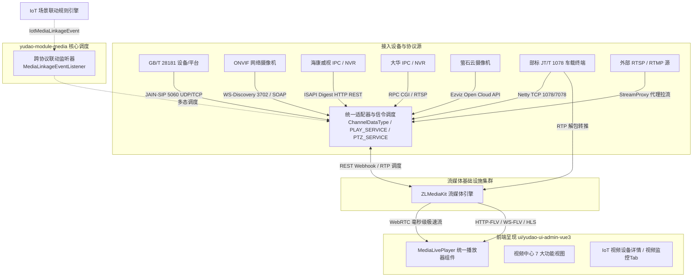

# MzMedia - 视频监控与流媒体中心 (`yudao-module-media`)

## 📌 模块定位与职责

`yudao-module-media` 是 MzMedia 平台的核心音视频子系统，采用高度解耦的多协议插件化架构，深度融合 **国标 GB/T 28181（2016/2022）协议栈**、**ONVIF 国际网络视频开放协议**、**海康威视 ISAPI 私有协议**、**大华 RPC/CGI 私有协议**、**萤石云开放平台 (Ezviz Cloud API)**、**交通部标 JT/T 1078 车载音视频协议** 以及 **ZLMediaKit 高性能流媒体服务器集群**。

本模块专为工业制造、智慧安防、车间巡检、园区安保、冷链车辆监控及环保监测等复杂场景打造，提供**设备一键发现与录入、多协议统一拉转推流、毫秒级超低延迟 WebRTC/FLV 直播、云台 PTZ 智能控制、双向语音对讲、24 小时连续时间轴录像回放、计划排程与跨系统联动抓拍**的全套流媒体中枢能力。

---

## 🏗️ 视频流转总体架构



---

## 📂 核心包目录结构

```text
cn.iocoder.yudao.module.media
├── common             # 媒体模块通用枚举与基类 (ChannelDataType, StreamInfo, VideoCodecType 等)
├── conf               # 国标 SIP 与流媒体服务器配置 (MediaConfig, SipConfig, DynamicTask)
├── dahua              # ★ 大华 HTTP RPC / CGI 协议栈 (DahuaRpcClient, PTZ/Play 适配服务, Controller)
├── ezviz              # ★ 萤石云开放平台协议栈 (EzvizApiClient, Token 自动缓存续期, 直播/PTZ 服务)
├── framework          # 框架扩展 (SIP 监听器装配, Webhook 认证切面)
├── gb28181            # ★ GB/T 28181 核心信令协议栈 (JAIN-SIP 注册鉴权, 目录检索, 级联)
├── hikvision          # ★ 海康威视 ISAPI 协议栈 (HikIsapiClient, Digest 认证, PTZ/Play 适配服务)
├── jt1078             # ★ 部标 JT/T 1078 车载音视频网关 (Netty 服务端 1078/7078, 帧解码器, 会话管理)
├── media              # ★ ZLMediaKit REST API 客户端与 Webhook 回调处理器
├── onvif              # ★ ONVIF 协议栈 (WS-Discovery 探测, SOAP UsernameToken 摘要鉴权, PTZ)
├── service            # 业务服务层接口与实现 (DeviceService, ChannelService, PlayService 等)
├── storager           # 媒体数据访问与持久化存储层 (MyBatis-Plus Mapper)
├── streamProxy        # 外部 RTSP/RTMP/HTTP 拉流代理服务
├── streamPush         # 自主推流分发服务
├── vmanager           # 视频中心 REST Controller 控制器层 (点播、PTZ、录像计划、集群看板、报警)
└── web                # Web 交互与 WebSocket 状态广播
```

---

## 💾 核心数据库表结构 (`sql/module/media-2026-11-12.sql`)

| 数据表名 | 实体业务定位 | 核心关键字段 | 说明与设计规范 |
| :--- | :--- | :--- | :--- |
| **`mz_video_device`** | 国标/监控设备主表 | `device_id`, `name`, `ip`, `port`, `transport`, `on_line`, `keepalive_time` | 记录国标 20 位编码、SIP 通信协议（UDP/TCP）及心跳状态。继承 TenantBaseDO。 |
| **`mz_video_channel`** | 设备物理/逻辑通道 | `device_id`, `channel_id`, `name`, `ptz_type`, `status`, `data_type` | 全局统一通道表，`data_type` 标识具体协议（1:GB28181, 4:ONVIF, 5:海康, 6:大华, 7:萤石, 200:JT1078）。 |
| **`mz_video_media_server`** | ZLMediaKit 节点 | `id`, `ip`, `http_port`, `rtmp_port`, `rtp_proxy_port`, `secret`, `hook_ip` | 流媒体服务器配置，支持单机或多节点分布式挂载与负载均衡。 |
| **`mz_video_platform`** | 上级国标级联平台 | `server_gb_id`, `server_ip`, `server_port`, `username`, `password`, `enable` | 向上级应急、安防或公安平台级联推送设备目录与视频流。 |
| **`mz_video_stream_proxy`** | 拉流代理任务表 | `app`, `stream`, `src_url`, `enable_audio`, `enable_mp4`, `pulling` | 将第三方 RTSP/RTMP 摄像头拉取到 ZLMediaKit 统一转码分发。 |
| **`mz_video_stream_push`** | 自主推流任务表 | `app`, `stream`, `push_time`, `pushing` | 接收无人机、推流软件等 RTMP/RTSP 推流。 |
| **`mz_video_record`** | 云端录像记录 | `app`, `stream`, `file_path`, `file_size`, `start_time`, `end_time` | ZLMediaKit 云端 MP4 切片录像索引与检索。 |
| **`mz_video_record_plan`** | 定时录像计划 | `name`, `snap`, `create_time` | 针对特定通道配置 7x24 小时或按周定时录像策略。 |
| **`mz_video_device_onvif`** | ONVIF 设备配置表 | `name`, `ip`, `port`, `username`, `password`, `profiles`, `stream_uri` | ONVIF 协议自动探测与 RTSP 取流地址。 |
| **`mz_video_device_hik`** | 海康威视 ISAPI 表 | `name`, `ip`, `port`, `username`, `password`, `channels`, `device_info` | 海康威视专用设备管理与 ISAPI 信令交互。 |
| **`mz_video_device_dahua`** | 大华私有协议表 | `name`, `ip`, `port`, `username`, `password`, `channels`, `device_info` | 大华设备 RPC 交互与流媒体代理。 |
| **`mz_video_device_ezviz`** | 萤石云开放平台表 | `name`, `app_key`, `app_secret`, `device_serial`, `channel_no`, `live_address` | 萤石云 OpenAPI 实时流拉取。 |
| **`mz_video_device_jt1078`** | JT/T 1078 车载终端表 | `sim_number`, `channel`, `plate_number`, `terminal_id`, `stream_id` | 交通部车载音视频终端协议交互与转推。 |
| **`iot_device.video_config`** | IoT 视频扩展字段 | `protocol`, `channel_id`, `device_id`, `stream_url`, `has_ptz` | IoT 传感器设备与视频监控的深度属性绑定。 |

---

## 📡 多协议视频接入全矩阵实现规格

### 1. 国标 GB/T 28181 (2016/2022)
- **信令协议栈**：JAIN-SIP (NIST) 双栈（UDP/TCP 5060）；
- **鉴权机制**：SIP Register 401 Digest 认证（MD5 摘要）；
- **信令全流程**：注册鉴权、Keepalive 心跳保活、Catalog 目录检索订阅、INVITE 动态 RTP 取流、云台 PTZ 控制（0x81 预置位）、双向语音对讲（G.711A/U）；
- **级联推送**：支持作为下级平台向上级公安或应急指挥平台推送音视频流与设备目录。

### 2. ONVIF 协议 (Profile S / G / T)
- **局域网设备探测**：基于 UDP 组播广播 WS-Discovery `Probe` 包（目标地址 `239.255.255.250:3702`），一键发现内网兼容摄像头；
- **SOAP 摘要认证**：采用 WS-UsernameToken 计算 Password Digest：`Base64(SHA-1(nonce + created + password))`；
- **媒体能力发现**：调用 `GetProfiles` 提取主码流与子码流 Token，调用 `GetStreamUri` 获取高标清 RTSP 取流地址；
- **云台控制**：封装 `ContinuousMove`（Pan/Tilt/Zoom 三轴速度向量 `[-1.0, 1.0]`）、`Stop` 停止指令与 `GotoPreset` 预置位调用；
- **控制器接口**：`/admin-api/media/onvif`（`probe`、`list`、`save`、`delete`、`sync`、`ptz`、`preset/goto`）。

### 3. 海康威视 ISAPI (HTTP REST Digest)
- **通信客户端**：基于 OkHttp3 自定义实现 Digest 摘要认证拦截器 (`DigestAuthenticator`)；
- **设备信息与通道同步**：调用 `GET /ISAPI/System/deviceInfo` 同步型号固件，调用 `GET /ISAPI/ContentMgmt/InputProxy/channels` 同步通道清单；
- **RTSP 取流规则**：自动拼装海康官方流规范 `rtsp://username:password@ip:port/Streaming/channels/101`（101 主码流、102 子码流）；
- **PTZ 与快照**：调用 `PUT /ISAPI/PTZCtrl/channels/{id}/continuous` 下发云台控制 XML 负载，调用 `GET /ISAPI/Streaming/channels/{id}/picture` 实时抓取现场照片；
- **控制器接口**：`/admin-api/media/hikvision`（`list`、`save`、`delete`、`sync`、`ptz`、`preset/call`）。

### 4. 大华私有协议 (HTTP RPC / CGI)
- **RPC 交互机制**：基于 Digest 摘要鉴权请求大华设备 CGI 服务；
- **通道探测**：调用 `GET /cgi-bin/magicBox.cgi?action=getSystemInfo` 探测硬件，调用 `GET /cgi-bin/configManager.cgi?action=getConfig&name=ChannelTitle` 提取通道名称；
- **RTSP 取流规则**：构建标准取流地址 `rtsp://username:password@ip:port/cam/realmonitor?channel={ch}&subtype=0`；
- **云台控制与抓图**：调用 `GET /cgi-bin/ptz.cgi?action=start&channel={ch}&code={code}&arg1={speed}&arg2={speed}` 驱动转动，调用 `GET /cgi-bin/snapshot.cgi?channel={ch}` 抓取快照；
- **控制器接口**：`/admin-api/media/dahua`（`list`、`save`、`delete`、`sync`、`ptz`、`preset/call`）。

### 5. 萤石云开放平台 (Ezviz Cloud API)
- **Token 托管**：维护 `appKey` 与 `appSecret`，自动请求换取并本地缓存 `accessToken`，过期自动无感刷新；
- **直播流拉取**：调用 `/api/lapp/v2/live/address/get` 获取超低延迟 FLV/HLS 直播地址（免固定公网 IP 限制）；
- **云台与抓图**：调用 `/api/lapp/device/ptz/start` & `/stop` 远程调向，调用 `/api/lapp/device/capture` 触发云端抓拍并获取 CDN 图片链接；
- **控制器接口**：`/admin-api/media/ezviz`（`list`、`save`、`delete`、`sync`、`ptz`）。

### 6. 部标 JT/T 1078 (车载视频流媒体网关)
- **标准遵循**：严格符合《JT/T 1078-2016 道路运输车辆卫星定位系统 视频通信协议》规范；
- **高性能网关服务**：Netty TCP 监听音视频数据端口 `1078` 与信令端口 `7078`；
- **报文帧解析 (`JT1078FrameDecoder`)**：识别 4 字节魔数 `0x30 0x31 0x63 0x64`，解码 BCD 终端手机号/SIM、逻辑通道号（1-驾驶员, 2-车辆正前, 3-车内全景, 4-车后门等）、数据类型（I帧/P帧/B帧/音频帧）、时间戳及 Payload；
- **会话与转推 (`JT1078SessionManager`)**：维持终端 TCP 会话，将音视频 Payload 解封装并实时转推至 ZLMediaKit RTP 收流端口完成 Web 端低延迟播放；
- **控制器接口**：`/admin-api/media/jt1078`（`list`、`save`、`delete`、`status`）。

---

## 🖥️ 前端“视频中心”全套界面与组件 (`ui/yudao-ui-admin-vue3`)

前端在 `src/views/media/` 目录下构建了完善的业务矩阵，并配套有通用播放器组件：

### 1. 通用播放器组件 (`src/components/MediaLivePlayer/index.vue`)
- **多流自适应**：支持 WebRTC（毫秒级超低延迟）、HTTP-FLV、HLS 协议自由切换与自适应降级；
- **8向云台圆盘**：360° 交互式云台控制盘（上/下/左/右/左上/右上/左下/右下/停止复位）；
- **镜头微调**：变倍（Zoom +/-）、聚焦（Focus +/-）、光圈（Iris +/-）精细步进控制；
- **调速滑块**：云台转速平滑调节（1 ~ 255）；
- **预置位管理**：预置位列表快速调用与添加当前视角为预置位；
- **辅助功能**：现场快照截图并自动下载、全屏切换、音频开关。

### 2. 视频中心 7 大功能页面
1. **实时预览 (`src/views/media/live/index.vue`, 菜单 26010)**：
   - 1 / 4 / 9 / 16 多分屏网格自由切换；
   - 左侧通道目录树，支持在线状态过滤与关键字检索；
   - 点击分屏槽位、双击通道快速上屏；支持“一键全部停止”。
2. **设备管理 (`src/views/media/device/index.vue`, 菜单 26020)**：
   - 多协议聚合 Tab 界面：GB28181、ONVIF（支持一键 WS-Discovery 探测发现对话框）、海康威视、大华、萤石云、JT1078 车载、拉流代理；
   - 支持多协议设备的增删改查、手动通道同步与通道列表抽屉查看。
3. **录像回放 (`src/views/media/playback/index.vue`, 菜单 26030)**：
   - 通道选择与日期日历选择；
   - 24 小时可视化连续时间轴刻度（绿色有效区间标注与游标拖拽定位）；
   - 播放/暂停、快进/快退 30s、0.5x~4x 倍速调节、录像切片文件列表与下载。
4. **录像计划 (`src/views/media/recordPlan/index.vue`, 菜单 26040)**：
   - 周一至周日 7×24 小时录像时间段可视化编辑器；
   - 通道批量穿梭框关联绑定。
5. **流媒体服务 (`src/views/media/server/index.vue`, 菜单 26050)**：
   - ZLMediaKit 流媒体服务器节点集群看板；
   - CPU 占用率、内存占用率、各协议端口运行状态与一键连通性自检。
6. **电子地图 (`src/views/media/map/index.vue`, 菜单 26060)**：
   - 电子地图 GIS 监控点位分布视图，经纬度标注与摄像机脉冲指示点；
   - 点击摄像机点位弹出浮窗，实时点播视频流并显示通道信息。
7. **报警记录 (`src/views/media/alarm/index.vue`, 菜单 26070)**：
   - 移动侦测、视频遮挡、周界入侵等报警事件流；
   - 级别标识（一级紧急/二级重要/三级提示）、抓拍快照预览、单条删除与一键清空。

---

## 🔗 IoT 视频监控设备与场景规则联动

1. **IoT 设备模型扩展**：
   - `IotProductDeviceTypeEnum.java`：增加 `VIDEO(3, "视频监控设备")` 及 `isVideo()` 判定；
   - `IotDeviceDO.java`：新增 `videoConfig` 视频配置字段（JSON 格式：存储协议、通道、流地址、云台标志）。
2. **前端 IoT 表单与详情页**：
   - `DeviceForm.vue`：新增“视频监控配置”折叠项，支持快速选择视频中心已接入的通道直接绑定；
   - `DeviceDetailsVideo.vue`：在 IoT 设备详情页新增“视频监控”Tab，嵌入播放器与云台控制，同屏呈现“看数据”与“看现场”。
3. **跨系统联动总线**：
   - `MediaLinkageEventListener.java`：监听 IoT 规则引擎派发的 `IotMediaLinkageEvent` 事件，依据设备前缀将指令路由到对应驱动（GB28181、ONVIF、海康、大华、萤石云、JT1078），实现传感器超限秒级驱动球机转动预置位、录像与抓拍。

---

## 🛠️ 配置项说明 (`application-local.yaml`)

```yaml
sip:
  ip: ${SIP_IP:192.168.1.100}         # SIP 服务器监听 IP (必须为设备可直接访问的实际 IP)
  port: 5060                          # SIP 端口 (UDP / TCP)
  id: 34020000002000000001            # SIP 服务端国标编码 (20位)
  domain: 3402000000                  # SIP 域 (前10位)
  password: admin                     # 接入默认设备鉴权密码
  timeout: 5                          # 信令响应超时时长 (秒)

media:
  id: default                         # 默认流媒体服务器 ID
  ip: ${MEDIA_IP:192.168.1.100}       # ZLMediaKit 宿主机 IP
  http-port: 80                       # ZLMediaKit HTTP 端口
  secret: 035c73f7-bb6b-4889-a715-d9eb2d1925cc # REST API 访问秘钥
  hook-ip: ${LOCAL_IP:192.168.1.100}  # ZLMediaKit 回调当前 yudao-server 的 IP

jt1078:
  enabled: true                       # 是否启用部标 JT/T 1078 车载音视频网关
  port: 1078                          # JT/T 1078 视频数据流接收端口
  msg-port: 7078                      # JT/T 1078 信令指令交互端口
```

---

## ⚠️ 常见排错指南

1. **设备注册显示在线，但点播提示超时或黑屏**：
   - 检查防火墙是否放行了 ZLMediaKit 的动态 RTP 端口范围（`30000-30500`）；
   - 确认 `sip.ip` 与 `media.ip` 不能为 `127.0.0.1`，必须是设备能直接路由的真实局域网或公网 IP。
2. **ONVIF 设备探测不到**：
   - 检查网络是否支持 UDP 多播（`239.255.255.250:3702`）；若在 Docker 中运行，宿主机网络模式需使用 `host` 模式。
3. **海康 / 大华设备提示鉴权失败**：
   - 确认摄像机后台开启了“CGI/ISAPI”权限；
   - 认证方式需勾选“Digest/摘要认证”或“WS-UsernameToken 认证”。
4. **JT/T 1078 车载设备无法推流**：
   - 检查车载终端配置的服务器 IP 及音视频端口是否为 `1078`；
   - 检查 SIM 手机号是否在平台车辆设备库中录入。
